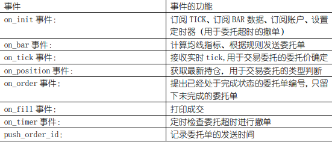
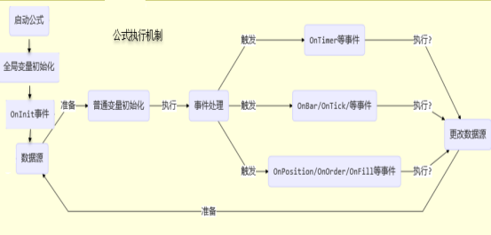
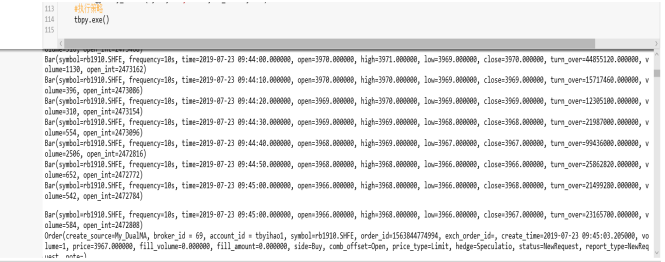
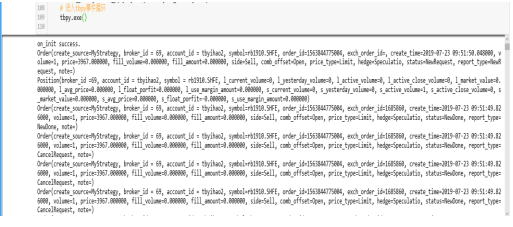

# TBPY

是一款可量化交易的python包，其运行依赖量化平台（如TBQuant3、TBQuant、简语言等）。

- 获取大量历史行情、资讯等数据
- 订阅实时行情、资讯等数据
- 实现量化平台交易通道的无缝对接
- 与量化平台实时数据交互等功能

## TBPY简介

TBPY是TBQuant和Python之间进行数据和交易的交互的函数包。通过在Python上安装TBPY这个函数包之后，交易者可以实现两方面的功能。一是在Python上读写TBQuant的数据。二是可以利用与TBQuant的通讯机制，经由TBQuant与交易所交互进行交易。

关于TBQuant和TBPY功能的划分：

1、TBQuant的启动是使用TBPY的前提

2、交易所行情的接收和账户交易的最后执行都是通过TBQuant进行。所以交易账户的登录也是在TBQuant上进行。

| 函数名字 | 实现功能 |
| --- | --- |
| 基本函数 |  |
| init | TBPY使用初始化 |
| Exe | 运行策略 |
| exit | 终止策略运行 |
| Get_last_err | 查询最近一次错误信息 |
| 行情数据 |  |
| Get_history_n | 查询历史行情最新N条 |
| Get_history | 查询历史行情 |
| Get_current_tick | 查询历史行情快照 |
| Get_instrument | 查询合约 |
| Get_main_instrument | 查询期货主力合约 |

## 1 安装

### 安装Anaconda

必须是python3.12

推荐版本：[https://repo.anaconda.com/archive/Anaconda3-5.2.0-Windows-x86_64.exe]

### conda虚拟环境安装tbpy

#### conda虚拟环境

创建虚拟环境 conda create -n py312 python=3.12

切换到py312环境 conda activate py312

pip install --force-reinstall tbpy-x.x.x.x-py3-none-any.whl

#### 安装tbpy

```bash
pip install --force-reinstall tbpy-x.x.x.x-py3-none-any.whl
```

## 2 约定

### 行情权限

- 有流量控制权限，如果频繁查询会失败
- 有申请历史范围控制权限
- 有订阅个数控制权限

### 交易权限

- 有下单控制权限

### 基础数据权限

- 有系统基础数据访问权限

### 认证约定

- 无须认证，但必须先启动支持TBPY的产品软件,调用tbpy.init指定产品，与对应的产品软件共享用户与权限
- 用户需要开通tbpy权限，否则无法正常使用

## 3 初始化

### 3.1 调用流程

#### 3.1.1 init 初始化tbpy,必须最先调用

复制

```
tbpy.init(key)
```

参数：

| 参数名 | 类型 | 说明 |
| --- | --- | --- |
| key | str | 指定连接的软件产品 |

返回值类型：

bool 返回True可正常工作返回False 调用 get_last_err() 查看失败原因

#### 3.1.2 exit 退出tbpy,调用init后可调用

#### 3.1.3 支持tbpy的产品列表

产品列表：

| key | 产品 |
| --- | --- |
| tbquant | TBQuant 量化平台 |
| tbquant3 | TBQuant3 量化平台 |
| tbquant3.easy | 简语言量化平台 |

最新支持的产品请咨询TB客服人员

## 4 查询数据

### 4.1 行情数据

#### 4.1.1 get_history_n-查询历史行情最新N条

复制

```python
tbpy.get_history_n(symbol, frequency, count, flag=tbpy.QuoteFlag.Null, fields: list=None, timeout='30s')
```

参数：

| 参数名 | 类型 | 说明 |
| --- | --- | --- |
| symbol | str or list | 合约代码。支持字符串格式，也支持['symbol1', 'symbol2']这种列表格式。 |
| [frequency](#7.3 frequency-周期) | str | 周期。 |
| count | int | 历史bar个数。 |
| flag | int | 取值为[QuoteFlag](#7.11.7 QuoteFlag-行情标志)，枚举值可以或运算。默认无设置 |
| fields | list | 需要获取的属性。支持['field1', 'field2']这种列表格式，默认值None表示获取所有属性。取值范围['open', 'close', 'high', 'low', 'volume', 'position','rollover', 'time']。 |
| timeout | str | 超时时间设定，支持s结尾表示单位秒，默认30s。 |

返回值类型：

symbol为str格式：dict{field: ndarray}

symbol为list格式：dict{[symbol](#7.1 symbol-合约代码): {field: ndarray}}

示例:

复制

```python
tbpy.get_history_n(symbol=['rb000.SHFE', 'a9000.DCE'], frequency='2m', count=10, flag=tbpy.QuoteFlag.RolloverBackWard|tbpy.QuoteFlag.OnlyNight, fields=['open', 'high', 'time'], timeout='10s')
```

#### 4.1.2 get_history-查询历史行情

复制

```python
tbpy.get_history(symbol, frequency, begin_time: datetime, end_time: datetime, flag=tbpy.QuoteFlag.Null, fields: list=None, timeout='30s')
```

参数：

| 参数名 | 类型 | 说明 |
| --- | --- | --- |
| symbol | str or list | 合约代码。支持字符串格式，也支持['symbol1', 'symbol2']这种列表格式。 |
| [frequency](#7.3 frequency-周期) | str | 周期。 |
| begin_time | datetime | 申请数据范围的起始时间 |
| end_time | datetime | 申请数据范围的结束时间 |
| flag | int | 取值为[QuoteFlag](#7.11.7 QuoteFlag-行情标志)，枚举值可以或运算。默认无设置 |
| fields | str or list | 需要获取的属性。支持['field1', 'field2']这种列表格式，默认值None表示获取所有属性。取值范围['open', 'close', 'high', 'low', 'volume', 'position','rollover', 'time']。 |
| timeout | str | 超时时间设定，支持s结尾表示单位秒，默认30s。 |

返回值类型：

symbol为str格式：dict{field: ndarray}

symbol为list格式：dict{[symbol](#7.1 symbol-合约代码): {field: ndarray}}

示例:

复制

```python
tbpy.get_history(symbol='a9000.DCE', frequency='1d', begin_time=datetime(2018, 10, 10), end_time=datetime(2018, 10, 10))
```

#### 4.1.3 get_current_tick-查询实时行情快照

复制

```python
tbpy.get_current_tick(symbol)
```

参数：

| 参数名 | 类型 | 说明 |
| --- | --- | --- |
| symbol | str or list | 合约代码。支持字符串格式，也支持['symbol1', 'symbol2']这种列表格式。 |

返回值类型：

symbol为str格式：成功返回 [Tick](#7.5 Tick-行情快照)，失败返回None

symbol为list格式：list[[Tick](#7.5 Tick-行情快照)]

> **坑（实测 2026-10-03 周六休市）**：① 休市/非交易时段 `get_current_tick` 拿不到行情时，tbpy 会**误报** `get_last_err()='查询实时失败,查询限制,间隔=60000ms,合约数量=20'`——此串与 `get_history_n` 限流同源，但**并非真被限流，只是无实时数据**；`time.sleep(62)` 越过 60s 窗口后**仍**报同样错误。② `get_last_err()` 为**粘性缓冲且依赖调用形态**：str 形态失败返回 `None` 且 `get_last_err()` 为空串、list 形态失败返回 `[]` 且 `get_last_err()` 才有该串。**结论**：只信任返回值（`None`/`[]`=无数据），绝不能用 `get_last_err()` 区分"限流"与"休市"；实时盘口只在盘中（`market_open=True`）才调用，休市一律回退日线 close / 缓存。

示例:

复制

```python
tbpy.get_current_tick(symbol='IF000.CFFEX')
```

#### 4.1.4 get_instrument-查询合约

复制

```python
tbpy.get_instrument(symbol=None)
```

参数：

| 参数名 | 类型 | 说明 |
| --- | --- | --- |
| symbol | str or list or None | 合约代码。支持字符串格式，也支持['symbol1', 'symbol2']这种列表格式。默认值None表示获取所有合约 |

返回值类型：

symbol为str格式：成功返回 [Instrument](#7.4 Instrument-合约)，失败返回None

symbol为list格式：list[[Instrument](#7.4 Instrument-合约)]

#### 4.1.5 get_main_instrument-查询期货主力合约

复制

```python
tbpy.get_main_instrument(underlying_symbol=None)
```

参数：

| 参数名 | 类型 | 说明 |
| --- | --- | --- |
| underlying_symbol | str or list or None | 品种代码。支持字符串格式，也支持['underlying_symbol1', 'underlying_symbol2']这种列表格式。默认值None表示获取所有主力合约 |

返回值类型：

symbol为str格式：成功返回[Instrument](#7.4 Instrument-合约)，失败返回None

symbol为list格式：list[[Instrument](#7.4 Instrument-合约)]

#### 4.1.6 get_second_main_instrument-查询期货次主力合约

复制

```python
tbpy.get_second_main_instrument(underlying_symbol=None)
```

参数：

| 参数名 | 类型 | 说明 |
| --- | --- | --- |
| underlying_symbol | str or list or None | 品种代码。支持字符串格式，也支持['underlying_symbol1', 'underlying_symbol2']这种列表格式。默认值None表示获取所有次主力合约 |

返回值类型：

symbol为str格式：成功返回[Instrument](#7.4 Instrument-合约)，失败返回None

symbol为list格式：list[[Instrument](#7.4 Instrument-合约)]

#### 4.1.7 write_history-写入历史行情数据

复制

```python
tbpy.write_history(symbol, frequency, filepath, timeout='30s')
```

参数：

| 参数名 | 类型 | 说明 |
| --- | --- | --- |
| symbol | str | 合约代码。 |
| [frequency](#7.3 frequency-周期) | str | 周期。 |
| filepath | str | 文件路径，文件格式支持csv格式。 |
| timeout | str | 超时时间设定，支持s结尾表示单位秒，默认30s。 |

返回值类型：

None or str。None表示写入成功。非None表示失败，返回失败原因str

#### 4.1.8 get_symbols-查询所有合约代码

复制

```python
tbpy.get_symbols()
```

返回值类型：

list：合约代码列表 ['IF2501.CFFEX']

### 4.2 基础数据

#### 4.2.1 write_fundamental-写入基础数据

复制

```python
tbpy.write_fundamental(name, symbol, time: datetime, value)
```

参数：

| 参数名 | 类型 | 说明 |
| --- | --- | --- |
| name | str | 名称(不支持中文且不能为空) |
| [symbol](#7.1 symbol-合约代码) | str | 合约代码(不支持中文且不能为空) |
| time | datetime | 时间 |
| value | bool or int or float or str or ndarray | 写入的值(不支持中文)。支持bool、int、float、str类型，ndarray支持bool、int、float、str的一维数组和二维数组。 |

返回值类型：

None or str。None表示写入成功。非None表示失败，返回失败原因str

示例：

复制

```python
tbpy.write_fundamental(name='name', symbol='rb000.SHFE', time=datetime(2018, 10, 10, 9, 45, 0),  value=True)
```

#### 4.2.2 get_fundamental-查询基础数据

复制

```python
tbpy.get_fundamental(name, symbol=None, begin_time: datetime=None, end_time: datetime=None, timeout='30s')
```

参数：

| 参数名 | 类型 | 说明 |
| --- | --- | --- |
| name | str | 名称(不支持中文且不能为空) |
| [symbol](#7.1 symbol-合约代码) | str or None | 合约代码(不支持中文且不能为空), 为None则获取所有 |
| begin_time | datetime or None | 开始时间, 为空默认为最小值 |
| end_time | datetime or None | 结束时间, 为空默认为最大值 |
| timeout | str | 超时时间设定，支持s结尾表示单位秒，默认30s。 |

返回值类型：

None or bool or int or float or str or ndarray。None表示读取失败，非None表示读取的值

示例：

复制

```python
tbpy.get_fundamental(name='name', symbol='rb000.SHFE', begin_time=datetime(2018, 10, 10, 9, 45, 0),  end_time=datetime(2018, 10, 10, 9, 45, 0))
```

#### 4.2.3 delete_fundamental-删除基础数据

复制

```python
tbpy.delete_fundamental(name, symbol=None, begin_time: datetime=None, end_time: datetime=None)
```

参数：

| 参数名 | 类型 | 说明 |
| --- | --- | --- |
| name | str | 名称(不支持中文且不能为空) |
| [symbol](#7.1 symbol-合约代码) | str or None | 合约代码(不支持中文且不能为空), 为None则删除所有 |
| begin_time | datetime or None | 开始时间, 为空默认为最小值 |
| end_time | datetime or None | 结束时间, 为空默认为最大值 |

返回值类型：

None or str。None表示删除成功。非None表示失败，返回失败原因str

示例：

复制

```python
tbpy.delete_fundamental(name='name', symbol='rb000.SHFE', begin_time=datetime(2018, 10, 10, 9, 45, 0), end_time=datetime(2018, 10, 10, 9, 45, 0))
```

#### 4.2.4 set_symbol_description-设置关联信息描述

复制

```python
tbpy.set_symbol_description(symbol, description)
```

参数：

| 参数名 | 类型 | 说明 |
| --- | --- | --- |
| [symbol](#7.1 symbol-合约代码) | str | 合约代码(不支持中文且不能为空) |
| description | str | 描述信息 |

返回值类型：

None or str。None表示设置成功。非None表示失败，返回失败原因str

示例：

复制

```python
tbpy.set_symbol_description(symbol='rb000.SHFE',  description='螺纹钢指数')
```

#### 4.2.5 set_name_description-设置关键字描述

复制

```python
tbpy.set_name_description(name, description)
```

参数：

| 参数名 | 类型 | 说明 |
| --- | --- | --- |
| name | str | 名称(不支持中文且不能为空), name必须已经存在 |
| description | str | 描述信息 |

返回值类型：

None or str。None表示设置成功。非None表示失败，返回失败原因str

示例：

复制

```python
tbpy.set_name_description(name='name',  description='xxx')
```

### 4.3 交易数据

#### 4.3.1 get_account-查询账户

复制

```python
tbpy.get_account(account_id, broker_id=0)
```

参数：

| 参数名 | 类型 | 说明 |
| --- | --- | --- |
| account_id | str | 资金账户ID |
| broker_id | int | 经纪商ID |

返回值类型

账户存在且已登录，返回Account，否则返回None。

示例：

复制

```python
account = tbpy.get_account(account_id='050323')
```

#### 4.3.2 send_order-下单

复制

```python
account.buy(symbol, volume, price)
account.sell(symbol, volume, price)
account.sell2short(symbol, volume, price)
account.buy2cover(symbol, volume, price)
account.send_order(symbol, volume, price, side, comb_offset, price_type=tbpy.PriceType.Limit)
```

参数

| 参数名 | 类型 | 说明 |
| --- | --- | --- |
| [symbol](#7.1 symbol-合约代码) | str | 合约代码 |
| volume | int | 下单数量 |
| price | double | 下单价格 |
| side | [OrderSide](#7.11.1 OrderSide-买卖方向) | 买卖方向 |
| comb_offset | [CombOffsetFlag](#7.11.3 CombOffsetFlag-开平标识) | 开平标志 |
| price_type | [PriceType](#7.11.2 PriceType-价格类型) | 价格类型 |

返回值类型：

成功返回list[order_id]，失败返回None

注：order_id为int类型，且单个账户内唯一

示例：

复制

```python
account.sell2short(symbol='rb1910.SHFE', volume=1, price=4000)
account.send_order(symbol='rb1910.SHFE', volume=1, price=4000, side=tbpy.OrderSide.Buy, comb_offset=tbpy.CombOffsetFlag.Open)
```

#### 4.3.3 cancel_order-撤单

复制

```python
account.cancel_order(order_id)
```

参数

| 参数名 | 类型 | 说明 |
| --- | --- | --- |
| order_id | int | 报单索引 |

返回值类型：

None表示请求成功。非None表示失败，返回失败原因str

#### 4.3.4 get_position-查询持仓

复制

```python
account.get_position(symbol)
account.get_position()
```

参数

| 参数名 | 类型 | 说明 |
| --- | --- | --- |
| [symbol](#7.1 symbol-合约代码) | str | 合约代码 |

返回值类型：

带symbol参数：成功返回[Position](#7.8 Position-持仓)，合约不存在，返回None

无参数：返回list[[Position](#7.8 Position-持仓)]

示例：

复制

```python
account.get_position('rb1910.SHFE')
account.get_position()
```

#### 4.3.5 get_order-查询委托

复制

```python
account.get_order(order_id)
account.get_order(symbol)
account.get_order()
```

参数：

| 参数名 | 类型 | 说明 |
| --- | --- | --- |
| order_id | int | 报单索引 |
| [symbol](#7.1 symbol-合约代码) | str | 合约代码 |

返回值类型：

带order_id参数：成功返回[Order](#7.9 Order-委托)，失败返回None

带symbol参数：返回list[[Order](#7.9 Order-委托)]

无参数：返回list[[Order](#7.9 Order-委托)]

示例：

复制

```python
account.get_order(order_id=123456789)
```

#### 4.3.6 get_notrade_order-查询未成交委托

复制

```python
account.get_notrade_order(symbol)
account.get_notrade_order()
```

参数

| 参数名 | 类型 | 说明 |
| --- | --- | --- |
| [symbol](#7.1 symbol-合约代码) | str | 合约代码 |

返回值类型：

带symbol参数：返回list[[Order](#7.9 Order-委托)]

无参数：返回list[[Order](#7.9 Order-委托)]

示例：

复制

```python
account.get_notrade_order(symbol='rb1910.SHFE')
```

#### 4.3.7 get_fill-查询成交

复制

```python
account.get_fill(symbol, side, fill_id)
account.get_fill(order_id)
```

参数：

| 参数名 | 类型 | 说明 |
| --- | --- | --- |
| [symbol](#7.1 symbol-合约代码) | str | 合约代码 |
| side | [OrderSide](#7.11.1 OrderSide-买卖方向) | 买卖方向 |
| fill_id | str | 成交编号（交易所） |
| order_id | int | 报单索引 |

返回值类型：

带symbol、side、fill_id参数：成功返回[Fill](#7.10 Fill-成交)，失败返回None

带order_id参数：返回list[[Fill](#7.10 Fill-成交)]

示例：

复制

```python
account.get_fill(order_id=123456789)
```

#### 4.3.8 get_status-查询账户状态

复制

```python
account.get_status()
```

参数：

无

返回值类型：

[AccountStatus](#7.11.6 AccountStatus-账户状态)

示例：

复制

```python
account.get_status()
```

### 4.4 其它

#### 4.4.1 init-初始化

复制

```python
tbpy.init(key ="tbquant")
#务须调用，返回True可正常工作
```

参数：

无

返回值类型：

bool

示例：

复制

```python
tbpy.init()
```

#### 4.4.2 exe-运行策略

复制

```python
tbpy.exe()
#开始运行tbpy策略
```

参数：

无

返回值类型：

无返回值

示例：

复制

```python
tbpy.exe()
```

#### 4.4.3 exit-终止策略运行

复制

```python
tbpy.exit()
```

参数：

无

返回值类型：

无返回值

示例：

复制

```python
tbpy.exit()
```

#### 4.4.4 get_last_err-查询最近一次错误信息

复制

```python
tbpy.get_last_err()
```

参数：

无

返回值类型：

str

示例：

复制

```python
tbpy.get_last_err()
```

## 5 事件数据

### 5.1 on_init-初始化驱动

复制

```python
on_init(self, context)
```

参数：

| 参数名 | 类型 | 说明 |
| --- | --- | --- |
| context | [Context](#6 Context-上下文) | 上下文 |

示例：

复制

```python
def on_init(self, context):
    context.subscribe_tick('rb000.SHFE')
```

### 5.2 on_tick-Tick数据驱动

复制

```python
on_tick(self, context, tick)
```

参数：

| 参数名 | 类型 | 说明 |
| --- | --- | --- |
| context | [Context](#6 Context-上下文) | 上下文 |
| tick | [Tick](#7.5 Tick-行情快照) | 主推的tick数据 |

示例：

复制

```python
def on_tick(self, context, tick):
    print(tick)
```

### 5.3 on_bar-Bar数据驱动

复制

```python
on_bar(self, context, bars, symbol, flag)
```

参数：

| 参数名 | 类型 | 说明 |
| --- | --- | --- |
| context | [Context](#6 Context-上下文) | 上下文 |
| bars | list[[Bar](#7.6 Bar-Bar数据)] | 主推的bar数据 |
| symbol | str | 合约代码 |
| flag | int | 0 - 历史，1 - 实时 |

示例：

复制

```python
def on_bar(self, context, bars, symbol, flag):
    for bar in bars:
        print(bar)
```

### 5.4 on_position-持仓数据驱动

复制

```python
on_position(self, context, position)
```

参数：

| 参数名 | 类型 | 说明 |
| --- | --- | --- |
| context | [Context](#6 Context-上下文) | 上下文 |
| position | [Position](#7.8 Position-持仓) | 主推的持仓数据 |

示例：

复制

```python
def on_position(self, context, position):
    print(position)
```

### 5.5 on_order-委托数据驱动

复制

```python
on_order(self, context, order)
```

参数：

| 参数名 | 类型 | 说明 |
| --- | --- | --- |
| context | [Context](#6 Context-上下文) | 上下文 |
| order | [Order](#7.9 Order-委托) | 主推的委托数据 |

示例：

复制

```python
def on_order(self, context, order):
    print(order)
```

### 5.6 on_fill-成交数据驱动

复制

```python
on_fill(self, context, fill)
```

参数：

| 参数名 | 类型 | 说明 |
| --- | --- | --- |
| context | [Context](#6 Context-上下文) | 上下文 |
| fill | [Fill](#7.10 Fill-成交) | 主推的成交数据 |

示例：

复制

```python
def on_fill(self, context, fill):
    print(fill)
```

### 5.7 on_timer-定时器数据驱动

复制

```python
on_timer(self, context, timer_id, interval_millsecs)
```

参数：

| 参数名 | 类型 | 说明 |
| --- | --- | --- |
| context | [Context](#6 Context-上下文) | 上下文 |
| timer_id | int | 定时对象id |
| interval_millsecs | int | 定时间隔 |

示例：

复制

```python
def on_timer(self, context, timer_id, interval_millsecs):
    print(timer_id)
```

## 6 Context-上下文

### 6.1 说明

复制

context是策略运行上下文环境，除了内置的方法，用户也可以随意为其自定义属性

### 6.2 订阅与退订Tick数据

复制

```python
context.subscribe_tick(symbol)
context.unsubscribe_tick(symbol)
```

参数：

| 参数名 | 类型 | 说明 |
| --- | --- | --- |
| symbol | str or list | 合约代码。支持字符串格式，也支持['symbol1', 'symbol2']这种列表格式。 |

返回值类型：

返回None表示成功，非None表示失败，返回失败原因str

示例：

复制

```python
context.subscribe_tick(symbol='rb000.SHFE')
context.unsubscribe_tick(symbol='rb000.SHFE')
```

### 6.3 订阅与退订Bar数据

复制

```python
context.subscribe_bar(symbol, frequency, begin_time=None, sliding_window=1, flag=tbpy.QuoteFlag.Null)
context.unsubscribe_bar(symbol, frequency)
```

参数：

| 参数名 | 类型 | 说明 |
| --- | --- | --- |
| symbol | str or list | 合约代码。支持字符串格式，也支持['symbol1', 'symbol2']这种列表格式。 |
| [frequency](#7.3 frequency-周期) | str | 周期 |
| begin_time | datatime | 开始时间，为None从当前时间开始 |
| sliding_window | int | 数据滑窗大小(on_bar每次回调的bar数)，默认1 |
| flag | int | 取值为[QuoteFlag](#7.11.8 QuoteFlag-行情标志)，枚举值可以或运算。默认无设置 |

返回值类型：

返回None表示成功，非None表示失败，返回失败原因str

示例：

复制

```python
context.subscribe_bar(symbol='rb000.SHFE', frequency='10s', begin_time=datetime.datetime.now(), sliding_window=1, flag=tbpy.QuoteFlag.RolloverBackWard)
context.unsubscribe_bar(symbol='rb000.SHFE', frequency='10s')
```

### 6.4 订阅Account数据

复制

```python
#订阅当前策略的委托、成交、持仓
context.subscribe_account(account_id)
#订阅指定委托源ID的委托、成交
context.subscribe_source_trade(source_id, account_id)
```

参数：

| 参数名 | 类型 | 说明 |
| --- | --- | --- |
| account_id | str | 资金账户ID |
| source_id | int | 取值[OrderSourceId](#7.11.9 OrderSourceId-委托来源ID)，枚举值可以或运算 |

返回值类型：

账户存在且已登录，如果订阅成功，返回Account，否则返回None

示例：

复制

```python
context.subscribe_account(account_id='085489')
context.subscribe_source_trade(source_id=tbpy.OrderSourceId.Program | tbpy.OrderSourceId.Algo, account_id='085489')
```

### 6.5 创建与关闭定时器

复制

```python
context.create_timer(interval_millsecs, begin_time=None, trigger_count=-1)
context.stop_timer(timer_id)
```

参数：

| 参数名 | 类型 | 说明 |
| --- | --- | --- |
| interval_millsecs | int | 定时间隔(ms) |
| begin_time | datetime | 起始时间，None表示当前时间 |
| trigger_count | int | 驱动次数，-1表示不限次数 |
| timer_id | int | 定时对象id |

返回值类型：

create_timer：int(timer_id) stop_timer：无返回值

## 7 附录

### 7.1 symbol-合约代码

str类型

| 取值 | 说明 |
| --- | --- |
| 如 'rb1901.SHFE' | 表示上期所的rb1901合约 |
| 如 'IF1902.CFFEX' | 表示中金所的IF1902合约 |
| 如 'user' | 表示自定义合约(不支持中文且不能为空) |

### 7.2 underlying_symbol-品种代码

str类型

| 取值 | 说明 |
| --- | --- |
| 如 'rb.SHFE' | 表示上期所的rb品种 |
| 如 'IF.CFFEX' | 表示中金所的IF品种 |

### 7.3 frequency-周期

str类型，如‘3h’表示3小时周期。大于等于'd'时，只支持'1d'、'1w'、'1mon'。

| 取值 | 说明 |
| --- | --- |
| 'tick' | Tick |
| 's' | 秒 |
| 'm' | 分钟 |
| 'h' | 小时 |
| 'd' | 天 |
| 'w' | 周 |
| 'mon' | 月 |

### 7.4 Instrument-合约

对象类型

| 属性 | 类型 | 说明 |
| --- | --- | --- |
| symbol | str | 合约代码 |
| exchange | str | 交易市场代码 |
| sec_id | str | 代码 (如 'rb1901') |
| sec_name | str | 合约名称 |
| price_tick | float | 最小变动价 |
| contract_unit | int | 交易单位 |
| big_point_value | float | 每点价值 |
| listed_date | datetime | 上市日期 |
| delisted_date | datetime | 退市日期 |

### 7.5 Tick-行情快照

对象类型

| 属性 | 类型 | 说明 |
| --- | --- | --- |
| time | datetime | 时间 |
| symbol | str | 合约代码 |
| open | float | 开盘价 |
| high | float | 最高价 |
| low | float | 最低价 |
| last | float | 最新价 |
| limit_up | float | 涨停价 |
| limit_down | float | 跌停价 |
| avg_price | float | 均价 |
| pre_close | float | 昨收价 |
| pre_settlement | float | 昨结价 |
| volume | int | 最新成交量 |
| total_volume | int | 总成交量 |
| bidasks | list[BidAsk] | 5档行情(不一定支持5档) |

#### BidAsk

对象类型

| 属性 | 类型 | 说明 |
| --- | --- | --- |
| bid_p | float | 买价 |
| bid_v | int | 买量 |
| ask_p | float | 卖价 |
| ask_v | int | 卖量 |

### 7.6 Bar-Bar数据

对象类型

| 属性 | 类型 | 说明 |
| --- | --- | --- |
| symbol | str | 合约代码 |
| frequency | str | 周期 |
| time | datetime | 开始时间 |
| open | float | 开盘价 |
| high | float | 最高价 |
| low | float | 最低价 |
| close | float | 收盘价 |
| turn_over | float | 成交金额 |
| volume | float | 成交量 |
| open_int | int | 持仓量 |
| rollover | float | 除权系数 |

### 7.7 exchange-交易所代码

str类型

| 取值 | 说明 |
| --- | --- |
| 'SHFE' | 上海期货交易所 |
| 'DCE' | 大连商品交易所 |
| 'CZCE' | 郑州商品交易所 |
| 'CFFEX' | 中国金融期货交易所 |
| 'INE' | 上海国际能源交易中心 |
| 'SSE' | 上海证券交易所 |
| 'SZSE' | 深圳证券交易所 |

### 7.8 Position-持仓

对象类型

| 属性 | 类型 | 说明 |
| --- | --- | --- |
| broker_id | int | 经济公司ID |
| account_id | str | 资金账户ID |
| symbol | str | 合约代码 |
| l_current_volume | int | 多头当前持仓 |
| l_yesterday_volume | int | 多头剩余昨仓 |
| l_active_volume | int | 多头未成交的报单净委托量 |
| l_active_close_volume | int | 多头未成交的报单平仓委托量 |
| l_can_sell_volume | int | 多头可平量 |
| l_market_value | float | 多头持仓市值 |
| l_avg_price | float | 多头均价（买均价,按结算价） |
| l_float_porfit | float | 多头浮动盈亏（买盈亏,按结算价） |
| l_avg_price_o | float | 多头均价（买均价,按成本价） |
| l_float_porfit_o | float | 多头浮动盈亏（买盈亏,按成本价） |
| l_use_margin_amount | float | 多头占用的保证金 |
| s_current_volume | int | 空头当前持仓 |
| s_yesterday_volume | int | 空头剩余昨仓 |
| s_active_volume | int | 空头未成交的报单净委托量 |
| s_active_close_volume | int | 空头未成交的报单平仓委托量 |
| s_can_cover_volume | int | 空头可平量 |
| s_market_value | float | 空头持仓市值 |
| s_avg_price | float | 空头均价（买均价,按结算价） |
| s_float_porfit | float | 空头浮动盈亏（买盈亏,按结算价） |
| s_avg_price_o | float | 空头均价（买均价,按成本价） |
| s_float_porfit_o | float | 空头浮动盈亏（买盈亏,按成本价） |
| s_use_margin_amount | float | 空头占用的保证金 |

### 7.9 Order-委托

对象类型

| 属性 | 类型 | 说明 |
| --- | --- | --- |
| broker_id | int | 经济公司ID |
| account_id | str | 资金账户ID |
| symbol | str | 合约代码 |
| order_id | int | 报单索引 |
| exch_order_id | str | 报单编号（交易所） |
| create_time | datetime | 报单委托时间 |
| volume | int | 委托量 |
| price | float | 委托价 |
| fill_volume | int | 成交量 |
| fill_amount | float | 成交金额 |
| side | [OrderSide](#7.11.1 OrderSide-买卖方向) | 买卖方向 |
| comb_offset | [CombOffsetFlag](#7.11.3 CombOffsetFlag-开平标识) | 开平标志 |
| price_type | [PriceType](#7.11.2 PriceType-价格类型) | 价格类型 |
| hedge | [HedgeFlag](#7.11.4 HedgeFlag-投保类型) | 投机套保 |
| status | [OrderStatus](#7.11.5 OrderStatus-报单状态) | 报单状态 |
| report_type | [OrderReportType](#7.11.6 OrderReportType-委托回报类型) | 报单回报类型 |
| create_source | str | 报单源 |
| note | str | 详细信息 |

### 7.10 Fill-成交

对象类型

| 属性 | 类型 | 说明 |
| --- | --- | --- |
| broker_id | int | 经济公司ID |
| account_id | str | 资金账户ID |
| symbol | str | 合约代码 |
| order_id | int | 报单索引 |
| exch_order_id | str | 报单编号（交易所） |
| volume | int | 委托量 |
| price | float | 委托价 |
| fill_id | str | 成交编号（交易所） |
| fill_time | datetime | 成交时间 |
| fill_volume | int | 成交量 |
| fill_price | float | 成交价 |
| side | [OrderSide](#7.11.1 OrderSide-买卖方向) | 买卖方向 |
| comb_offset | [CombOffsetFlag](#7.11.3 CombOffsetFlag-开平标识) | 开平标志 |
| price_type | [PriceType](#7.11.2 PriceType-价格类型) | 价格类型 |
| hedge | [HedgeFlag](#7.11.4 HedgeFlag-投保类型) | 投机套保 |

### 7.11 常量

#### 7.11.1 OrderSide-买卖方向

复制

```python
OrderSide.Unknown
OrderSide.Buy        #买
OrderSide.Sell       #卖
```

#### 7.11.2 PriceType-价格类型

复制

```python
PriceType.Unknown
PriceType.Limit      #限价
PriceType.Market     #市价
```

#### 7.11.3 CombOffsetFlag-开平标识

复制

```python
CombOffsetFlag.Unknown
CombOffsetFlag.Open              #开仓
CombOffsetFlag.Close             #平仓
CombOffsetFlag.CloseToday        #平今
CombOffsetFlag.CloseYesterday    #平昨
```

#### 7.11.4 HedgeFlag-投保类型

复制

```python
HedgeFlag.Unknown
HedgeFlag.Speculatio     #投机
HedgeFlag.Arbitrage      #套利(不支持)
HedgeFlag.Hedge          #套保(不支持)
HedgeFlag.MarketMaker    #市商(不支持)
```

#### 7.11.5 OrderStatus-报单状态

复制

```python
OrderStatus.Unknown
OrderStatus.NewRequest      #申请上报
OrderStatus.NewDone         #申报成功
OrderStatus.NewReject       #申报失败
OrderStatus.PartialFill     #部分成交
OrderStatus.AllFill         #完全成交
OrderStatus.CanceledFill    #部成部撤
OrderStatus.Canceled        #已撤单
```

#### 7.11.6 OrderReportType-委托回报类型

复制

```python
OrderReportType.Unknown
OrderReportType.NewRequest       #申请上报
OrderReportType.NewReject        #申报失败
OrderReportType.NewDone          #申报成功
OrderReportType.CancelRequest    #发送撤单
OrderReportType.CancelReject     #撤单被拒
OrderReportType.CancelDone       #撤单成功
OrderReportType.FillReport       #成交
```

#### 7.11.7 AccountStatus-账户状态

复制

```python
AccountStatus.Unknown
AccountStatus.Init                #正在初始化
AccountStatus.Connecting          #正在连接
AccountStatus.ConnectFail         #连接失败
AccountStatus.Disconnected        #连接断开
AccountStatus.Connected           #连接成功
AccountStatus.DisconnectFail      #断开连接失败
AccountStatus.Authenticating      #正在认证
AccountStatus.AuthenticateFail    #认证失败
AccountStatus.Authenticated       #认证完成
AccountStatus.Logout              #登出成功
AccountStatus.Logining            #正在登录
AccountStatus.LoginFail           #登录失败
AccountStatus.Logined             #登录成功
AccountStatus.SyncData            #已登录(同步数据中)
AccountStatus.OnService           #已登录(服务中)
```

#### 7.11.8 QuoteFlag-行情标志

复制

```python
QuoteFlag.Null
QuoteFlag.OnlyNight           #仅夜盘
QuoteFlag.OnlyDay             #仅日盘
QuoteFlag.RolloverBackWard    #后复权
```

#### 7.11.9 OrderSourceId-委托来源ID

复制

```python
OrderSourceId.Extra      #非本机
OrderSourceId.Manual     #手工
OrderSourceId.Program    #程序化
OrderSourceId.TBPY       #TBPY
OrderSourceId.Algo       #算法中心
OrderSourceId.Helper     #交易助手
OrderSourceId.Monitor    #头寸监控
OrderSourceId.Model      #模式
OrderSourceId.All        #全部
```

## TBPY使用案例

### 1. 双均线交易

#### 策略的思路

短周期均线上穿长周期均线，平掉空头仓位，开出多头仓位；短周期均线下破长周期均线，平掉多头仓位，开出空头仓位。通过这个策略我们可以了解下如何在 python 里面结合 TBQuant 的运行机制写策略。

#### 主要关注点

##### 1、策略的类如何定义和启动

策略的类的定义需要定义类的初始化和类的各种事件；策略的类的启动则直接用 tbpy.exe()指令启动。

##### 2、各种事件的主要完成什么功能

事件驱动的事件功能简介可以参照学习资料《事件驱动的案例讲解》。我们这里只对本策略用到的事件做出介绍。



##### 3、事件驱动的运行机制是怎么样

这里只给出事件驱动的示意图，关于事件驱动的细节可以查看学习资料《事件驱动的案例讲解》。



##### 4、self 和 context 的使用

这两个参数在每个事件驱动中都是默认要用的。所以如果对类不熟悉的化，需要简单了解下 self 和 context 的意义和用法。 self 是在类的方法中的，在调用此方法时，不用给 self 赋值，Python 会自动给他赋值，而且这个值就是类的实例--对象本身。 Context 是上下文，可以理解为成一个环境参数的结合,在当前环境下你能拿到的参数都可以从 context 出发去拿环境。比如在代码中，在初始化时定义了 context 的 K 线，TICK，账户信息，定时器等。在其它事件驱动中都可以读取到这些信息。

##### 5、关于交易账户的处理

交易账户是在 TBQuant 里面登录完成，在 PYTHON 的策略参数当中制定账户 ID，就可以使用策略读取账户相关信息并发送委托指令，驱动 TBQuant 与交易所进行通讯。

#### 完整代码如下：

复制

```python
# encoding utf-8
import tbpy
import sys
import datetime

class My_DualMA(tbpy.IStrategy):
    def __init__(self, fast_length, slow_length, account_id, symbol):
        super().__init__('My_DualMA')
        self._fast_length = fast_length
        self._slow_length = slow_length
        self._account_id = account_id
        self._symbol = symbol
        self._account = None
        self._tick = None
        self._pos = None
        self._order_dict = {}
        self._timer_id = 0
        pass

    def __del__(self):
        pass

    def on_init(self, context):
        ret = context.subscribe_tick(symbol=self._symbol)
        if ret is not None:
            print(ret)
            tbpy.exit()
        ret = context.subscribe_bar(symbol=self._symbol, frequency='10s', begin_time=datetime.datetime.now()-datetime.timedelta(minutes=self._slow_length), sliding_window=self._slow_length)
        if ret is not None:
            print(ret)
            tbpy.exit()
        self._account = context.subscribe_account(account_id=self._account_id)
        if self._account is None:
            print(tbpy.get_last_err())
            tbpy.exit()
        self._timer_id = context.create_timer(interval_millsecs=5000)
        self._tick = tbpy.get_current_tick(symbol=self._symbol)
        self._pos = self._account.get_position(symbol=self._symbol)
        print('on_init success.')

    def on_bar(self, context, bars, symbol, flag):
        print(bars[len(bars)-1])
        # flag=0 历史数据；flag=1 实时数据
        if flag != 1:
            return
        if self._tick is None:
            return
        if self._account.get_status() != tbpy.AccountStatus.OnService:
            return
        fast_avg = sum(bar.close for bar in bars[(-self._fast_length - 1):-1]) / self._fast_length
        slow_avg = sum(bar.close for bar in bars[(-self._slow_length - 1):-1]) / self._slow_length
        if fast_avg > slow_avg:
            if self._pos is None:
                self.push_order_id(self._account.buy(symbol=symbol, volume=1, price=self._tick.last))
            else:
                if self._pos.s_can_cover_volume > 0:
                    self.push_order_id(self._account.buy2cover(symbol=symbol, volume=self._pos.s_can_cover_volume, price=self._tick.last))
                if self._pos.l_current_volume + self._pos.l_active_volume + self._pos.l_active_close_volume < 2:
                    self.push_order_id(self._account.buy(symbol=symbol, volume=1, price=self._tick.last))
        elif fast_avg < slow_avg:
            if self._pos is None:
                self.push_order_id(self._account.sell2short(symbol=symbol, volume=1, price=self._tick.last))
            else:
                if self._pos.l_can_sell_volume > 0:
                    self.push_order_id(self._account.sell(symbol=symbol, volume=self._pos.l_can_sell_volume, price=self._tick.last))
                if self._pos.s_current_volume + self._pos.s_active_volume + self._pos.s_active_close_volume < 2:
                    self.push_order_id(self._account.sell2short(symbol=symbol, volume=1, price=self._tick.last))

    def on_tick(self, context, tick):
        # print(tick)
        self._tick = tick

    def on_position(self, context, pos):
        print(pos)
        self._pos = pos

    def on_order(self, context, order):
        print(order)
        if order.status == tbpy.OrderStatus.NewReject or order.status == tbpy.OrderStatus.AllFill or \
                        order.status == tbpy.OrderStatus.Canceled or order.status == tbpy.OrderStatus.CanceledFill:
            self._order_dict.pop(order.order_id)

    def on_fill(self, context, fill):
        print(fill)
        pass

    def on_timer(self, context, id, millsecs):
        now_time = datetime.datetime.now()
        for key, value in self._order_dict.items():
            if (now_time - value).seconds >= 10:
                self._account.cancel_order(order_id=key)

    def push_order_id(self, order_id_list):
        send_time = datetime.datetime.now()
        for id in order_id_list:
            self._order_dict[id] = send_time

if __name__ == '__main__':
    ret = tbpy.init('tbquant3')
    if ret is False:
        print('init fail.')
        sys.exit()

    rb_main = tbpy.get_main_instrument(underlying_symbol='rb.SHFE')
    if rb_main is None:
        sys.exit()
    strategy = My_DualMA(5, 10, '66113172', rb_main.symbol)
    tbpy.exe()
```

#### 运行结果：



### 2. 读写数据

#### 行情数据和基础数据的读写操作

复制

```python
# encoding utf-8
import tbpy
import sys
from datetime import datetime
import numpy as np


if __name__ == '__main__':
    init = tbpy.init('tbquant3')
    if init is False:
        print('init fail.')
        sys.exit()

    print('init success.')
    # get quote test
    # get history kline by count
    # get_history_n(symbol, frequency, count, fields: list=None, timeout='30s')
    history = tbpy.get_history_n(symbol='rb000.SHFE', frequency='1d', count=1)
    print(history)
    history = tbpy.get_history_n(symbol=['rb000.SHFE', 'a9000.DCE'], frequency='1m', count=10, fields=['open', 'high', 'time'], timeout='10s')
    print(history)

    # get history kline by begin/end time
    # get_history(symbol, frequency, begin_time: datetime, end_time: datetime, fields: list=None, timeout='30s')
    history = tbpy.get_history(symbol='IF888.CFFEX', frequency='1d', begin_time=datetime(2019, 1, 1), end_time=datetime(2019, 8, 1), flag=tbpy.QuoteFlag.RolloverBackWard)
    print(history)

    # get_quote(symbol)
    tick = tbpy.get_current_tick(symbol='IF000.CFFEX')
    print(tick)
    tick = tbpy.get_current_tick(symbol=['IF000.CFFEX', 'a9000.DCE', 'CF000.CZCE'])
    print(tick)

    # get_instrument(symbol=None)
    # get all instrument
    instrument = tbpy.get_instrument()
    print(instrument)
    # get instrument by symbol
    instrument = tbpy.get_instrument(symbol=['IF000.CFFEX', 'a9000.DCE'])
    print(instrument)

    # get_main_instrument(underlying_symbol=None)
    # get all main instrument
    instrument = tbpy.get_main_instrument()
    print(instrument)
    # get main instrument by underlying_symbol
    instrument = tbpy.get_main_instrument(underlying_symbol='IF.CFFEX')
    print(instrument)
    instrument = tbpy.get_main_instrument(underlying_symbol=['rb.SHFE', 'a.DCE'])
    print(instrument)
    # get_second_main_instrument(underlying_symbol=None)
    # get second main instrument by underlying_symbol
    instrument = tbpy.get_second_main_instrument(underlying_symbol='PF.CZCE')
    print(instrument)

    # write fundamental test
    bool_val = True
    int_val = 123456789
    double_val = 123456.123456
    str_val = 'hello world!'
    bool_1d_val = np.array([True, False, True, False])
    int_1d_val = np.array([11, 22, 33, 44])
    double_1d_val = np.array([11.11, 22.22, 33.33, 44.44])
    str_1d_val = np.array(['hello', 'world', '!', '这个世界', '很好', '！'])
    bool_2d_val = np.array([[True, False, True, False], [False, True, False, True]])
    int_2d_val = np.array([[11, 22, 33, 44], [111, 222, 333, 444]])
    double_2d_val = np.array(
        [[11.1111111, 22.222222, 33.333333, 44.444444], [111.222222, 222.333333, 333.456789, 444.012345]])
    str_2d_val = np.array([['tb', 'python', 'api'], ['非常', '好的', '平台']])

    # write_fundamental(name, symbol, time: datetime, value)
    # write single bool value
    tbpy.write_fundamental(name='bool', symbol='rb000.SHFE', time=datetime(2018, 10, 31, 14), value=bool_val)
    tbpy.write_fundamental(name='bool', symbol='rb888.SHFE', time=datetime(2018, 10, 31, 14), value=bool_val)
    tbpy.write_fundamental(name='bool', symbol='rb1910.SHFE', time=datetime(2018, 10, 31, 14), value=bool_val)
    # write single int value
    tbpy.write_fundamental(name='int', symbol='rb000.SHFE', time=datetime(2018, 10, 31, 14), value=int_val)
    # write single double array
    tbpy.write_fundamental(name='double', symbol='rb000.SHFE', time=datetime(2018, 10, 31, 14), value=double_val)
    # write single str value
    tbpy.write_fundamental(name='str', symbol='rb000.SHFE', time=datetime(2018, 10, 31, 14), value=str_val)
    # write bool 1d array
    tbpy.write_fundamental(name='bool_1d_array', symbol='rb000.SHFE', time=datetime(2018, 10, 31, 14),
                           value=bool_1d_val)
    # write int 1d array
    tbpy.write_fundamental(name='int_1d_array', symbol='rb000.SHFE', time=datetime(2018, 10, 31, 14), value=int_1d_val)
    # write double 1d array
    tbpy.write_fundamental(name='double_1d_array', symbol='rb000.SHFE', time=datetime(2018, 10, 31, 14),
                           value=double_1d_val)
    # write str 1d array
    tbpy.write_fundamental(name='str_1d_array', symbol='rb000.SHFE', time=datetime(2018, 10, 31, 14), value=str_1d_val)
    # write bool 2d array
    tbpy.write_fundamental(name='bool_2d_array', symbol='rb000.SHFE', time=datetime(2018, 10, 31, 14),
                           value=bool_2d_val)
    # write int 2d array
    tbpy.write_fundamental(name='int_2d_array', symbol='rb000.SHFE', time=datetime(2018, 10, 31, 14), value=int_2d_val)
    # write double 2d array
    tbpy.write_fundamental(name='double_2d_array', symbol='rb000.SHFE', time=datetime(2018, 10, 31, 14),
                           value=double_2d_val)
    # write str 2d array
    tbpy.write_fundamental(name='str_2d_array', symbol='rb000.SHFE', time=datetime(2018, 10, 31, 14), value=str_2d_val)

    # get_fundamental(name, symbol=None, begin_time: datetime=None, end_time: datetime=None, timeout='30s')
    # read bool value
    values = tbpy.get_fundamental(name='bool', begin_time=datetime(2018, 10, 31, 14),
                                  end_time=datetime(2018, 10, 31, 14))
    print(values)
    # read int value
    value = tbpy.get_fundamental(name='int', symbol='rb000.SHFE', begin_time=datetime(2018, 10, 31, 14),
                                 end_time=datetime(2018, 10, 31, 14))
    print(value)
    # read double value
    value = tbpy.get_fundamental(name='double', symbol='rb000.SHFE', begin_time=datetime(2018, 10, 31, 14),
                                 end_time=datetime(2018, 10, 31, 14))
    print(value)
    # read str value
    value = tbpy.get_fundamental(name='str', symbol='rb000.SHFE', begin_time=datetime(2018, 10, 31, 14),
                                 end_time=datetime(2018, 10, 31, 14))
    print(value)
    # read bool 1d array
    value = tbpy.get_fundamental(name='bool_1d_array', symbol='rb000.SHFE', begin_time=datetime(2018, 10, 31, 14),
                                 end_time=datetime(2018, 10, 31, 14))
    print(value)
    # read int 1d array
    value = tbpy.get_fundamental(name='int_1d_array', symbol='rb000.SHFE', begin_time=datetime(2018, 10, 31, 14),
                                 end_time=datetime(2018, 10, 31, 14))
    print(value)
    # read double 1d array
    value = tbpy.get_fundamental(name='double_1d_array', symbol='rb000.SHFE', begin_time=datetime(2018, 10, 31, 14),
                                 end_time=datetime(2018, 10, 31, 14))
    print(value)
    # read str 1d array
    value = tbpy.get_fundamental(name='str_1d_array', symbol='rb000.SHFE', begin_time=datetime(2018, 10, 31, 14),
                                 end_time=datetime(2018, 10, 31, 14))
    print(value)
    # read bool 2d array
    value = tbpy.get_fundamental(name='bool_2d_array', symbol='rb000.SHFE', begin_time=datetime(2018, 10, 31, 14),
                                 end_time=datetime(2018, 10, 31, 14))
    print(value)
    # read int 2d array
    value = tbpy.get_fundamental(name='int_2d_array', symbol='rb000.SHFE', begin_time=datetime(2018, 10, 31, 14),
                                 end_time=datetime(2018, 10, 31, 14))
    print(value)
    # read double 2d array
    value = tbpy.get_fundamental(name='double_2d_array', symbol='rb000.SHFE', begin_time=datetime(2018, 10, 31, 14),
                                 end_time=datetime(2018, 10, 31, 14))
    print(value)
    # read str 2d array
    value = tbpy.get_fundamental(name='str_2d_array', symbol='rb000.SHFE', begin_time=datetime(2018, 10, 31, 14),
                                 end_time=datetime(2018, 10, 31, 14))
    print(value)

    # delete_fundamental((name, symbol=None, begin_time: datetime=None, end_time: datetime=None)
    tbpy.delete_fundamental(name='bool', symbol='rb000.SHFE', begin_time=datetime(2018, 10, 31, 14),
                                  end_time=datetime(2018, 10, 31, 14))
    values = tbpy.get_fundamental(name='bool')
    print(values)

    tbpy.delete_fundamental(name='bool')
    values = tbpy.get_fundamental(name='bool')
    print(values)

    tbpy.delete_fundamental(name='int', symbol='rb000.SHFE', begin_time=datetime(2018, 10, 31, 14))
    values = tbpy.get_fundamental(name='int')
    print(values)

    tbpy.delete_fundamental(name='double')
    tbpy.delete_fundamental(name='str')
    tbpy.delete_fundamental(name='bool_1d_array')
    tbpy.delete_fundamental(name='int_1d_array')
    tbpy.delete_fundamental(name='double_1d_array')
    tbpy.delete_fundamental(name='str_1d_array')
    tbpy.delete_fundamental(name='bool_2d_array')
    tbpy.delete_fundamental(name='int_2d_array')
    tbpy.delete_fundamental(name='double_2d_array')
    tbpy.delete_fundamental(name='str_2d_array')

    # set_name_description(name, description)
    tbpy.set_name_description(name='int', description='整型')
```

### 3. 高频交易案例

#### 一个简单的高频交易策略

##### 策略思路：

每个 TICK 都会检查持仓状态，间隔一定时间就可以发送委托。当前时刻可能形成的最大多头持仓如果超出限制，则交易方向为空头；当前时刻可能形成的最大空头持仓如果超出限制，则交易方向为多头；

##### 关注点：

在双均线的案例当中我们熟悉了在 PYTHON 中如何利用 TBQuant 的事件驱动机制进行交易。在本案例和上一个案例的区别其实不是很大。主要体现在双均线交易是放在 onbar 事件中，而本策略是放在 ontick 事件中进行。

##### 完整代码如下：

复制

```python
# encoding utf-8
import tbpy
import sys
import datetime

# 自定义策略，须继承 tbpy.IStrategy
class MyStrategy(tbpy.IStrategy):
    def __init__(self, max_pos, interval_secs, account_id, symbol):
        super().__init__('MyStrategy')
        self._side = 0
        self._max_pos = max_pos
        self._interval_secs = interval_secs
        self._account_id = account_id
        self._symbol = symbol
        self._account = None
        self._pos = None
        self._order_dict = {}
        self._time= None
        pass

    def __del__(self):
        pass

    # 初始化事件函数
    def on_init(self, context):
        ret = context.subscribe_tick(symbol=self._symbol)
        if ret is not None:
            print(ret)
            tbpy.exit()
        self._account = context.subscribe_account(account_id=self._account_id)
        if self._account is None:
            print(tbpy.get_last_err())
            tbpy.exit()
        context.create_timer(interval_millsecs=2*100)
        self._pos = self._account.get_position(symbol=self._symbol)
        print('on_init success.')

    # BAR事件函数
    def on_bar(self, context, bars, symbol, flag):
        pass

    # TICK事件函数
    def on_tick(self, context, tick):
        if self._time is not None and (datetime.datetime.now() - self._time).seconds <= self._interval_secs:
            return
        l_up_pos = self._pos.l_current_volume + self._pos.l_active_volume - self._pos.l_active_close_volume
        s_up_pos = self._pos.s_current_volume + self._pos.s_active_volume - self._pos.s_active_close_volume
        if l_up_pos >self._max_pos:
            self._side = -1
        if s_up_pos >self._max_pos:
            self._side = 1

        if self._side > 0:
            if s_up_pos == 0:
                self.push_order_id(self._account.buy(symbol=tick.symbol, volume=1, price=tick.last))
            elif self._pos.s_current_volume > 0:
                self.push_order_id(self._account.buy2cover(symbol=tick.symbol, volume=1, price=tick.last))
        else:
            if l_up_pos == 0:
                self.push_order_id(self._account.sell2short(symbol=tick.symbol, volume=1, price=tick.last))
            elif self._pos.l_current_volume > 0:
                self.push_order_id(self._account.sell(symbol=tick.symbol, volume=1, price=tick.last))
        self._time = datetime.datetime.now()

    # 持仓事件函数
    def on_position(self, context, pos):
        print(pos)
        self._pos = pos

    # 委托事件函数
    def on_order(self, context, order):
        print(order)
        if order.status == tbpy.OrderStatus.NewReject or order.status == tbpy.OrderStatus.AllFill or \
                        order.status == tbpy.OrderStatus.Canceled or order.status == tbpy.OrderStatus.CanceledFill:
            self._order_dict.pop(order.order_id)

    # 成交事件函数
    def on_fill(self, context, fill):
        print(fill)
        pass

    # 定时器事件函数
    def on_timer(self, context, id, millsecs):
        now_time = datetime.datetime.now()
        for key, value in self._order_dict.items():
            if (now_time - value).seconds >= self._interval_secs:
                self._account.cancel_order(order_id=key)

    def push_order_id(self, order_id_list):
        send_time = datetime.datetime.now()
        for id in order_id_list:
            self._order_dict[id] = send_time

if __name__ == '__main__':
    # TBPY模块初始化
    ret = tbpy.init('tbquant3')
    if ret is False:
        print('init fail.')
        sys.exit()

    rb_main = tbpy.get_main_instrument(underlying_symbol='rb.SHFE')
    if rb_main is None:
        sys.exit()
    # 声明用户策略对象
    strategy = MyStrategy(5, 5, '66113172', rb_main.symbol)
    # 进入tbpy事件循环
    tbpy.exe()
```

##### 运行结果


