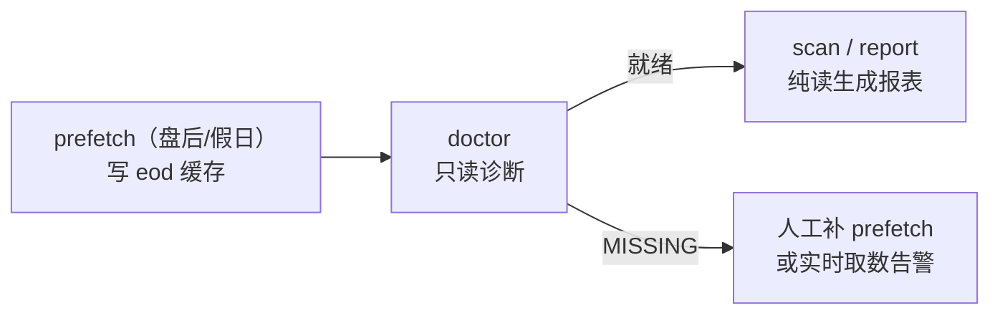

# 命令架构三拆分方案（维护 / 检查 / 报表解耦）

> 状态：**方案固化（未实施）**。本文档是后续代码改造的依据，不改动任何 `.py`。
> 与 `docs/数据架构与缓存策略.md` 的关系：本文档把该文档 §3 规划的 `prefetch`（Phase 1 预取）与 `scan --offline`（Phase 2）细化为**三个互不耦合的命令阶段**，并明确"报表/检查阶段绝不写库"的硬约束。

## 0. 目标与硬约束

- 把现有命令面拆成三个独立阶段：
  1. **数据维护 = `prefetch`**（写库）
  2. **数据检查 = `doctor`**（只读诊断）
  3. **生成报表 = `scan` / `check` / `exit` / `report`**（只读使用）
- **硬约束：报表与检查阶段绝不写任何库**（`calendar.db` / `spot.db` / `premium.db` / `daily.db` / `iv_snapshot.db`）。写库**只发生在 `prefetch` 被显式调用时**。
- 命名约定：
  - 维护命令沿用 `docs/数据架构与缓存策略.md` 已规划的 **`prefetch`**（Phase 1 预取）；
  - 检查命令建议 **`doctor`**（亦可 `check-data`，见 §7 待决）；
  - 报表沿用现有 `scan` / `check` / `exit` / `report`。

## 1. 现状问题（耦合证据）

当前"维护"与"报表/检查"混在一起，报表/检查路径里藏着隐式写库：

1. **`scan` 顺手做维护** —— `cmd_scan` 盘后调 `_prewarm`，直接写 `spot.db` / `daily.db`，`run_pool` 的 combo 还会写 `premium.db`，最后才生成日报：

```369:374:sell_option/strategy/cli.py
        if not getattr(session, "open", False):
            with flow("预取 现货/指数", 时段=mode):
                try:
                    _prewarm(rt, today, verbose=False)   # ← 维护动作混在 scan 里
```

2. **`check` / `exit` / `scan` 的提醒块隐式落盘 FOMC** —— `default_runtime().events` 用 `include_macro=True`，每次拉 FOMC 都落盘 `fomc_cache`：

```203:203:sell_option/strategy/cli.py
        events=lambda: fetch_d15_events(include_expiry=True, include_macro=True),
```

```414:414:sell_option/fetchers/d15_calendar.py
    _save_fomc_db(all_events)   # ← 每次 fetch 都写库，连 check/exit 都会触发
```

3. **combo 合并取数路径也会写库**（历史已知缺口）：`combo_oi_close_batch` 命中 miss 后取数并 `repo.save`，未看 `market_open`，盘中价可能被当收盘价存 `premium.db`：

```393:393:sell_option/fetchers/d09_d10_premium.py
            repo.save(sym, pull_date, close_val, "daily_close", bar_date_val, oi=pos_val)
```

4. **`refresh` 已是显式独立的维护命令**（刷新 `daily.db`），说明"维护"概念本就存在，只是没从 `scan` 里剥离干净。

5. **`report` 当前已是纯读**（只打印已有日报，不重新生成），但它只是"查看"，真正的"生成报表"是 `scan` 内的 `_build_report` + `write_report`，而该路径带着上面 1、2 处写库。

## 2. 三部分职责

### 2.1 ① 数据维护 = `prefetch`（写库，盘后/假日运行）

命令：`sellopt prefetch [--calendar] [--market] [--fomc] [--all] [--force]`

| 子开关 | 动作 | 落库目标 |
|---|---|---|
| `--calendar` | 播种交易日历 + 交易时段 | `calendar.db.manual_calendar` / `session_hours`（复用 `seed_holidays.py` 的 `main`） |
| `--market` | 拉 D08 现货 / D09-D10 权利金+OI / D12 日线 / D13 IV | `spot.db` / `premium.db` / `daily.db` / `iv_snapshot.db` |
| `--fomc` | 主动拉美联储日程并落盘 | `calendar.db.fomc_cache`（网络失败优雅降级，维护表兜底） |
| `--all`（默认） | 以上全做 | — |
| `--force` | 强制全量重拉（默认只补缺） | — |

- **前置约束**：`prefetch` 必须限定在**非交易时段**运行（盘后/假日）。这恰好堵死"盘中预热把即时价当收盘价"的来源。
- **写入语义**：`--market` 写出的行情必须是 **`eod`（收盘确认值）**，依赖 `is_session_finalized(symbol, now)` 逐品种判自身时段是否已收盘（含夜盘跨日归属）；未收盘品种跳过并告警"待收盘后预热"。详见 §5。
- **产出**：数据就绪报告（逐品种 Verdict，MISSING 标红），供 `doctor` 或人眼复核。

### 2.2 ② 数据检查 = `doctor`（只读诊断，绝不写库）

命令：`sellopt doctor`

只读核对并输出健康报告，不落任何库：

- `calendar.db`：
  - `manual_calendar` 是否覆盖**当前年份 / 今天**（跨年未重跑会退化为朴素跳过周末，需告警）；
  - `session_hours` 对 47 品种覆盖率（无夜盘品种是否显式覆盖，避免夜间误判开盘——参考已修复的 `lh` 案例）；
  - `fomc_cache` 是否存在且 `updated` 距今 ≤ `FOMC_CACHE_MAX_AGE_DAYS`（默认 7 天）。
- 行情库（`spot` / `premium` / `daily` / `iv_snapshot`）：是否有所属 `pull_date` 的 **`eod`** 数据（缺失 → 标 MISSING）。

输出：分级健康报告（OK / WARN / MISSING），不修改任何一行数据。

### 2.3 ③ 生成报表（只读使用，绝不维护）

| 命令 | 改造点 | 写库？ |
|---|---|---|
| `scan` | 移除内部 `_prewarm`（预取移入 `prefetch`）；若未 `prefetch` 直接跑，退化为实时取数并警告"未预取"；`_build_report` 全程只读 | 否 |
| `check` | `events` 改只读（见 §4），移除隐式 FOMC 落盘 | 否 |
| `exit` | 同上，`events` 改只读 | 否 |
| `report` | 保持纯读（打印最新日报） | 否 |

### 2.4 数据时效分类与特殊处理（A/B 类 + positions 特例）

三拆分只完整适用于**可缓存的离线/收盘值**。按"数据的时效性质"必须分两类，否则会把 tick 这种实时数据错误塞进 `prefetch`。

#### 数据表时效归属

| 表（库） | 时效类别 | 维护（谁写） | 检查（doctor） | 报表（只读） |
|---|---|---|---|---|
| `manual_calendar` / `session_hours` / `fomc_cache`（`calendar.db`） | A 离线可缓存 | `prefetch --calendar` / `--fomc` | 覆盖/时效诊断 | 只读 |
| `spot_price`（`spot.db`） | A 离线可缓存（eod） | `prefetch --market`（收盘确认后写 eod） | eod 缺失 = MISSING | 只读 eod |
| `premium`（`premium.db`） | A 离线可缓存（eod） | `prefetch --market`（eod） | eod 缺失 = MISSING | 只读 eod |
| `index_daily`（`daily.db`） | A 离线可缓存 | `prefetch --market` / `refresh` | eod 缺失 = MISSING | 只读 |
| `iv_snapshot`（`iv_snapshot.db`） | A 离线可缓存 | `prefetch --market` | eod 缺失 = MISSING | 只读 |
| **tick 盘口（实时）** | **B 实时** | **不进 `prefetch`（无法预取）** | 仅查"实时通道是否可用"，不查"是否预取" | 运行中实时取、只标 `intraday`、**绝不落 eod** |
| `positions`（`positions.db`） | 业务真相（特例） | **开/平仓动作写**（非预取） | 结构完整性 / 未平仓 vs 已平仓一致性对账 | 只读展示 |

#### B 类（实时 tick）的处理原则

- **不进 `prefetch`**：tick 是"当下"的数据，盘前预取到的也是过期快照，无意义。它在架构里归为独立的**「实时取数层（live fetch）」**，与 `prefetch`（离线预取）并列，但**明确不属于维护阶段**。
- **报表阶段可实时取，但绝不写 eod**：呼应 `--session open/closed`（`cli.py:218-224`）——盘中（`open` 全链路）模式需要实时价 → 实时取 live tick；盘后（`closed` 粗筛）走 `eod` 缓存，tick 不用。无论哪种模式，tick 值只标 `intraday`，绝不落 `eod`（否则回到"盘中即时价被当收盘价"的老问题）。
- 现有代码已有共识：`d09_d10_premium.py:543` 的 `if src_label == "tick": continue`（tick 盘口不缓存）、`d08_spot_price.py:372` 的 `if market_open is not True`（非盘中不写）。
- `doctor` 对 B 类：不检查"是否预取"（它本就不预取），最多检查"实时取数通道是否可用"。

#### positions 特例（业务真相）

- `positions` 是**业务真相**（真实持仓），不是行情缓存，删了不能自动重建（见 `docs/DB设计说明.md` §9）。
- 它的"维护"是**开/平仓交易动作写**，不是 `prefetch` 预取；因此不归入 `prefetch` 命令。
- `doctor` 对它的检查是**对账性质**：结构完整性、未平仓/已平仓一致性、与行情缓存的对账，而非"是否预取"。
- 报表（`exit` / 持仓块）只负责只读展示。

## 3. 改造后命令面总览

| 命令 | 阶段 | 是否写库 | 说明 |
|---|---|---|---|
| `prefetch [--calendar|--market|--fomc|--all|--force]` | ① 维护 | **是** | 盘后/假日运行，写全部缓存（eod） |
| `doctor` | ② 检查 | 否 | 只读诊断，输出健康报告 |
| `scan` | ③ 报表 | 否 | 全池扫描 + 生成综合日报（纯读，未预取则实时取数并告警） |
| `check M [--dual]` | ③ 报表 | 否 | 单品种检查（纯读） |
| `exit` | ③ 报表 | 否 | 持仓平仓扫描（纯读） |
| `collect-oi -c M` | ③ 报表 | 否 | 实时采 OI 不落盘（已是） |
| `refresh [--all]` | ① 维护（子集） | 是 | 刷新日线缓存；可并入 `prefetch --market` 或保留 |
| `scope` | — | 否 | 边界表〔待建〕 |
| `report` | ③ 报表 | 否 | 打印最新日报（已是） |

## 4. 关键改动清单（实施时落地）

| 文件 | 改动 |
|---|---|
| `sell_option/fetchers/d15_calendar.py` | `fetch_fomc_events` / `fetch_d15_events` 增加 `write_cache: bool = False` 形参；`fetch_d15_events` 透传给 `fetch_fomc_events`；仅 `write_cache=True` 时调用 `_save_fomc_db`。 |
| `sell_option/strategy/cli.py` | 1) `default_runtime().events` 改用只读版 `fetch_d15_events(..., write_cache=False)`；2) `cmd_scan` 移除 `_prewarm` 调用（或改 `--prefetch` 可选、默认不写）；3) 新增 `cmd_prefetch`（组：calendar/market/fomc）、`cmd_doctor`。 |
| `sell_option/strategy/cli.py` `build_parser` | 新增 `prefetch`（子开关见 §2.1）、`doctor` 子命令。 |
| `seed_holidays.py` | 被 `prefetch --calendar` 复用（`import` 其 `main`，不再需手动 `python seed_holidays.py`）。 |
| （可选）`sell_option/fetchers/d09_d10_premium.py` | `combo_oi_close_batch` 增加 `market_open` 闸门（对齐 §1 证据 3），仅 `prefetch` 路径写 eod；报表路径走 live tick。 |

## 5. 前置依赖与衔接

- **与 `docs/数据架构与缓存策略.md` 的衔接**：`prefetch` = 该文档 Phase 1（预取+质检）；该文档 Phase 2（`scan --offline`，纯缓存、不触 tbpy）在本文中被落实为"`scan` 默认纯读"，`--offline` 仅作为"禁止实时取数、缺失即 MISSING"的强化开关。
- **缓存 `eod` / `intraday` 标记 + 收盘确认闸门 `is_session_finalized`**：这是 `prefetch --market` 写出 `eod` 的前置（见历史讨论"盘中价≠收盘价"）。需先行或同期落地，否则盘中即时价会混入 `eod`，报表据此生成错误结论。读取优先级 `eod > intraday`；报表/检查只认 `eod`。
- **`is_session_finalized(symbol, now)`**：逐品种用 `session_hours.is_trading_time` 判当日是否已越过收盘（含夜盘跨日归属到正确交易日）；只有 finalized 才允许 `prefetch` 写 `eod`。

## 6. 时序与运行约定



- 日常：盘后跑 `prefetch --all` → 跑 `doctor` 确认就绪 → 跑 `scan` 出日报。
- 节假日/跨年：`prefetch --calendar` 重播种（尤其跨年需覆盖新年份）。
- 紧急查看：`report` 直接看最新日报（纯读，零副作用）。

## 7. 待决

- **检查命令命名**：`doctor` 还是 `check-data`（语义等价，二选一）。
- **`is_session_finalized` 的跨夜归属细节**：夜盘至 02:30 的品种，次日 00:00–02:30 视为"前一交易日未收盘"，需明确归属规则。
- **`prefetch --market` 增量 vs 全量**：默认只补缺（`pull_date` 缺才拉），`--force` 全量重拉。
- **`refresh` 去留**：可保留独立，亦可并入 `prefetch --market`（倾向并入，减少命令面离散度）。
- **tick 实时通道可用性是否纳入 `doctor`**：§2.4 规定 B 类（实时 tick）不预取，`doctor` 对其"最多检查实时通道是否可用"。需拍板：是否显式把"实时取数通道可用性"列为 `doctor` 的一项检查（如探测 tbpy 连接 / 抽样一个 tick 取数验证），还是 `doctor` 只管 eod 缓存完整性、实时通道问题交由报表运行时的优雅降级暴露（缺则 MISSING）。
