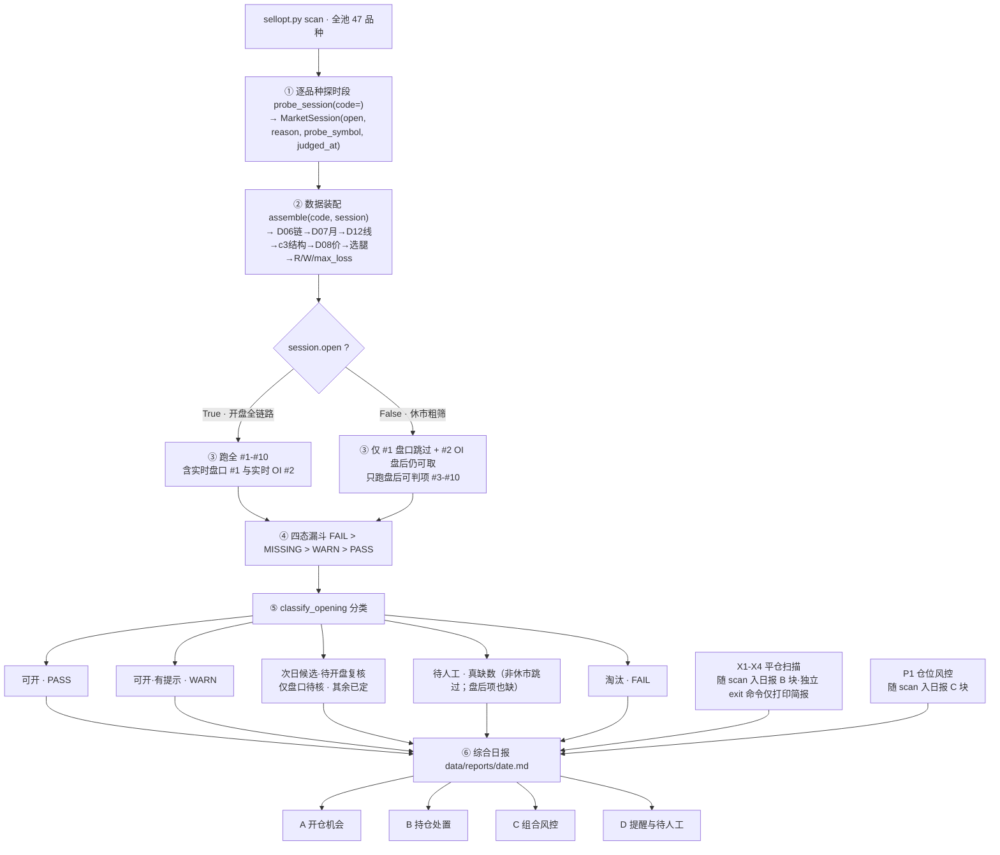
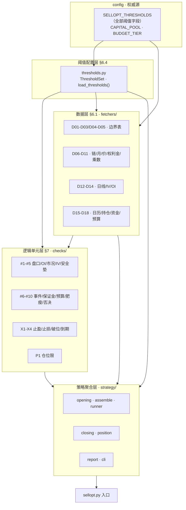

# 期权卖出策略工具 · 需求文档

> 本文是唯一需求源（WHAT）；实现参考（目录结构 / 命令面 / tbpy 平台限制）见 §十一，免责声明见 §十二。
> 权威品种数据与 symbol 编码规则在 `品种边界表.md`（取数层逐行加载）。

## 一、核心约束（既往教训）
1. **绝对价口径**：后复权主连指数价不得当真实合约价用（豆粕指数 ≈14798、真实 ≈2900）——否则安全垫 / 封顶 / 肥瘦 / 保证金全部失真。
2. **结论可得性**：IV 分位、盘口 / 持仓量在冷启动或盘后常缺；缺数一律如实判 MISSING，绝不伪造。
3. **规则以本文为准**：检查项与阈值逐条以 §七 为唯一源。

## 二、产品定位
- 只读决策支持工具：数据分析 + 生成报告 + 交易提醒（事件 / 长假 / 破位 / 到期）。
- 不接账户、不下单、不自动交易；人工看报告自行决策与下单。
- "可开 / 不可开"仅是机械化检查结论，非投资建议；下单前人工复核盘口与保证金实数。

## 三、策略核心
- **适用场景**：震荡市收取时间价值 + 波动率下降收益。
- **卖平值或虚值价差（风险封顶）**：卖出平值或虚值（看时间价值）+ 买入更虚值保护腿（预防单边趋势风险），构成垂直价差（credit spread）或铁鹰。
- 单笔最大亏损封顶 =（价差宽度 − 净权利金）× 乘数。
- **术语（全程封顶、绝不裸卖）**：
  - **单卖** ＝ 一侧垂直价差（卖 ＋ 买保护腿，2 腿）；
  - **双卖 / 铁鹰** ＝ 上下两侧价差（4 腿）＝ 两个单卖；
  - 均带保护腿、最大亏损封死；**不做任何裸卖**（风险无限）。

## 四、数据口径铁律（最高优先级）
两层价格体系，绝不混用：
- **连续指数合约**（主力连续 888 / 9888；000 / 9000 加权口径不采用，见边界表 §二.4.4）：靠拼接才连续、有换月台阶 → 唯一需要后复权，只用于相对指标（收益率 / 波动率 / 趋势 / ADX / 区间位置 / 跳空）。
- **真实月份合约**（如 m2701）：本身即真实价 → 不复权，用于一切绝对价（现价 / 行权价 / 权利金 / 买卖报价 / 保证金 / 安全垫 / 封顶 / 肥瘦）；有期限，历史仅"上市 → 到期"。
- **推论**：长窗口相对指标（ATR、趋势斜率、区间位置）只建在指数上；IV 分位由 openvlab 在其自身平值 IV 序列上自算（窗口约一年）、不在我方拼接序列上；绝对价只取当下真实合约。混用即缺陷；报告中两口径分列标注。

## 五、品种范围
- = 边界表《品种边界表.md》现有 47 个品种。
- 日常扫描：47 全扫（受限流约束首拉 ≈3 批，时长可接受）。

## 六、数据层需求（由 §七 反推 · 三源分工、绝不串价）
> 推导原则：§七 每条规则 → 需要哪些数据 → 每个数据项绑唯一权威源；无规则引用的数据不收录。
> 可得性标注：✅＝实测可得；⚠＝有断点，见 §6.3。

### 6.1 数据项总表
> 粒度原则：一行＝一个单一用途、可能独立缺失/判 MISSING 的数据项；编号 D01–D18 连续，供 §七 规则、报告字段与缺数处理引用。同一抓取动作带回的字段（如期权链）不强行拆行。
> 注：全部判定阈值（#1–#10 · DTE · 破位档 · 仓位限等）不属数据项，独立为阈值配置层（见 §6.4）。

| # | 数据项 | 口径 | 权威源 | 供给规则 | 可得性 | 备注 |
|---|---|---|---|---|---|---|
| D01 | 47 品种名单（含中文名） | 静态参数 | `品种边界表.md`（人工维护） | §五扫描范围 · 报告品种名 | ✅ | 唯一权威源；改动须人工 |
| D02 | symbol 拼接格式模板 | 静态参数 | 边界表 | 一切 symbol 拼接的取数入口 | ✅ | 按边界表 §二.4.2 编码规则 |
| D03 | 主力指数合约映射（品种→888/9888） | 静态参数 | 边界表 | #3 #10 指数日线取数对象 | ✅ | 000/9000 加权口径不采用 |
| D04 | 保证金率 | 静态参数 | 边界表（单腿保证金列反推） | #7 | ✅ | tbpy 无保证金字段，估算制为准、结果标注『估算』 |
| D05 | 组合优惠系数 | 静态参数 | 边界表（实际占用列反推；DCE·GFEX ×0.20） | #7 | ✅ | 随保证金率一并人工维护 |
| D06 | 期权链合约清单（行权价×到期日×C/P） | 元数据 | 主源 tbpy（option_index，子进程预建）；备源 ① 新浪期权链页（仅主力月行权价阶梯、弱备源）② openvlab 实测无行权价阶梯、无法独立建链，仅作新浪 month_resolver／到期日兜底（见 §6.2） | #1 #2 #5 #8 #9 · 7.2 选腿 · 7.3 · D07 反推 | ✅ 主源 / ⚠ 备源 | symbol 解析按边界表 §二.4.2；链清单＝元数据非价格，多源不碰串价铁律；外部源合约须经 tbpy get_instrument 单合约复核有效（全源拿不到→该品种 MISSING） |
| D07 | 标的月份集合映射（品种→有挂牌期权的标的期货真实月份，标主力） | 元数据 | 候选月由 D06 期权链反推（主源）；主力标记＝隔离子进程 `_main_month_builder` 调 tbpy get_main_instrument 落盘 `data/main_month.json`（当日缓存・旧缓存 ≤7 天复用），主进程 provider 只读文件——主进程直调实测必 AV 0xC0000005（未连接裸调，2026-10-02），与 get_symbols 同范式隔离 | D08–D11 入口 · 7.2 选月份 | ✅ | 取数对象不限主力月；候选集＝有挂牌期权 ∧ DTE 20–180 ∧ 前 N＝3 近月（§7.2）；主力标记仅供展示（D07/D08 自检 ★・主力现价）——D13 IV 路由不消费它（openvlab 自身即主力月口径）；缓存拿不到→全不标、不阻断 |
| D08 | 标的现价（每候选标的月真实合约各一份，不限主力月） | 绝对价 | tbpy tick | #5 · #7 #8 #9 · 7.3 破位（以持仓所属标的月为准） | ✅ | 绝不用指数价替代；多月份查询注意 tbpy 限流（20 只/批·62s 冷却，同 D12）；缓存按「归属交易日 pull_date」严格查/落（见 §6.2 取数归属交易日） |
| D09 | 卖腿权利金·买一卖一 | 绝对价 | tbpy tick（盘中）／该期权日线 close（盘后回退） | #1 价差 · #8 净权利金 · #9 肥瘦 · 7.3 平仓估值 | ✅ 盘中全盘口 / 盘后值可回退 | 双路（d09_d10_premium.py）：盘中 get_current_tick 取 bidasks[0].bid_p/ask_p＋last；盘后回退该期权合约 get_history_n('1d',count=1).close；买卖价差 #1 盘后无源→单独 MISSING；缓存按「归属交易日 pull_date」严格查/落（见 §6.2） |
| D10 | 保护腿权利金·买一卖一 | 绝对价 | tbpy tick（盘中）／该期权日线 close（盘后回退） | #1 价差（两腿都查）· #8 封顶宽度 | ✅ 盘中全盘口 / 盘后值可回退 | 与 D09 同机制（role 区分卖腿/保护腿）、独立缺失独立判 |
| D11 | 合约乘数 | 静态参数 | 边界表"乘数"列 | #7 #8 #9 一切金额 | ✅ | 直接从边界表读（品种规格值） |
| D12 | 主连指数日线（后复权，≥250 条） | 相对指标 | tbpy get_history_n ＋ RolloverBackWard | #3（ADX＋20日斜率＋连N同向软动能）· #10（跳空 / 区间贴边 / ATR 扩张）· #5 ATR 对账 | ✅ | 限流 20 只/批＋62s 冷却（限流 60s + 余量，见 §6.2／§11.3），首拉 ≈3 批；#10 跳空须在后复权序列上判；缓存按「归属交易日 pull_date」严格查/落（见 §6.2） |
| D13 | ATM IV 现值·百分位·日变·N 日序列 | 波动率 | openvlab `/api/ctamap-all` 的 atmv_current/atmv_percentile/atmv_1dchg（纯 HTTP，主力月 47/47，无需浏览器/登录）；本地每日快照攒序列（方向主判据＝IV 日变 1 日；N 日判据待积累后启用）；非主力月逐月 IV 见 §6.3 E | #4 水平·方向 · #5 预期移动 | ✅ 主力月 / ⚠ 非主力月待验证 | 落地 d13_iv_snapshot.py；tbpy 期权链反解仅对账、不作判定源；非主力月拿不到→回退主力月 IV 并标注『近似』；openvlab 抖动＋当日快照缺失→回退该品种最近一日已落地快照（get_recent），选腿/#5 不静默失效（修复了回退分支因 OpenvlabIV 缺省字段抛错被吞的根因） |
| D14 | 合约级 OI（卖腿＋保护腿各单合约） | 数量 | tbpy get_history_n → position 字段（最新日线 OI，盘后/假日可得）＝唯一源（新浪无商品期权合约行情、openvlab 无合约级 OI——实测不可行，备源已移除） | #2 门槛 ≥100（两腿分别查） | ✅ 含盘后/假日 | OI 是数量非价格，不碰串价铁律；Tick 无 oi、get_history_n 的 open_int 空——正确字段是 position；拿不到→MISSING |
| D15 | 事件日历 ＋ 长假日历 | 日历 | 长假＝`calendar.db.manual_calendar` 读取（is_open=0 闭市日连休分组，2026 全年逐日预写）；到期＝tbpy 期权链元数据自动派生（D07 候选月 expiry）；宏观(FOMC)＝美联储官网自动拉取（拉取不到优雅降级）；events.json 仅作可选人工标注层（FOMC/事件，非日历） | #6 提醒 · 7.3 事件·长假提示 | ✅ | 只提醒、不否决、不强制平；合一文件 d15_calendar.py；长假源已彻底去 tbpy/JSON |
| D16 | 持仓记录（开仓+平仓共用一表，status 区分） | 人工录入 | positions.db（sqlite3） | 7.3 全部平仓判据 · 7.4 仓位限三值（总笔数/每品种/同持品种数） | ✅ | 开仓 INSERT status='open'，平仓 UPDATE status='closed'+exit 字段；空表=没开仓。表结构见下方示例 |
| D17 | 资金池 | 静态参数 | config（4 万 / 100% / 单笔 1 万） | #7 合计 ≤100%×资金池 | ✅ | 仅开仓时作合计闸门（存量+拟开新仓占用 ≤100%×资金池）；超限只否决该新仓、不强平存量、不用于 §7.3 与日常监控 |
| D18 | 预算档（单笔封顶） | 静态参数 | config（3000 元/笔） | #8 ≤3000 | ✅ | 单笔最大亏损 ≤ 预算档 |

**D16 positions.db 表结构与示例**（开平仓共用一表，status 区分）。设计原则——**只存不变量**：到期存【最后交易日 expiry_date】（合约挂牌信息直接照抄、永不变），DTE 是派生量一律现算 `(expiry_date − today).days`、**不入库**（旧方案存「开仓日剩几天」快照，逼人工口算、录错一次永久错，已废）：
```sql
-- 表结构（开仓 + 平仓共用一行，status 区分）
CREATE TABLE positions (
    id INTEGER PRIMARY KEY AUTOINCREMENT,
    -- 开仓信息
    entry_date TEXT,      -- 开仓日 YYYY-MM-DD
    code TEXT,            -- 品种 M/rb/AP
    exchange TEXT,        -- 交易所 DCE/SHFE/CZCE/GFEX
    structure TEXT,       -- single_call/single_put（单腿侧价差，带保护腿）。双卖铁鹰(iron_condor) 落库时拆成两笔单腿录入，本表不单独存 iron_condor——与 assemble.c3 词汇一致
    short_symbol TEXT,    -- 卖腿 symbol 如 m2701-P-3300
    short_strike REAL,
    short_premium REAL,   -- 卖腿净收入
    short_bid REAL,       -- 卖腿买一（§7.3 止盈判断）
    short_ask REAL,       -- 卖腿卖一（平仓估值）
    prot_symbol TEXT,     -- 保护腿 symbol。本策略落库两结构均带保护腿：single_call/single_put 为单腿侧价差、prot_* 非 NULL；仅完全裸卖（不在 structure 枚举内）才为 NULL
    prot_strike REAL,
    prot_premium REAL,    -- 保护腿净支出
    max_loss REAL,        -- 最大亏损 =（价差宽度 − 净权利金）× 乘数
    expiry_date TEXT,     -- 到期日（期权最后交易日 YYYY-MM-DD，不变量；m2701＝2026-12-07，标的月前月第 5 交易日）；DTE 现算不入库
    margin REAL,          -- 保证金占用额（元）
    -- 状态 + 平仓信息（平仓时 UPDATE 填入）
    status TEXT DEFAULT 'open',           -- 'open' 持仓 / 'closed' 已平仓
    exit_date TEXT,                       -- 平仓日
    exit_short_premium REAL,              -- 平仓时卖腿权利金
    exit_prot_premium REAL,               -- 平仓时保护腿权利金
    realized_pnl REAL,                    -- 已实现盈亏
    exit_reason TEXT,                     -- 止盈/止损/破位/到期/手动
    note TEXT
);

-- 开仓示例：卖出豆粕 2701 Put 3300 价差
INSERT INTO positions (entry_date, code, exchange, structure,
    short_symbol, short_strike, short_premium, short_bid, short_ask,
    prot_symbol, prot_strike, prot_premium,
    max_loss, expiry_date, margin, status, note)
VALUES ('2026-09-21', 'M', 'DCE', 'single_put',
    'm2701-P-3300', 3300, 53.0, NULL, NULL,
    'm2701-P-3250', 3250, 36.5,
    335, '2026-12-07', 335, 'open', '卖出 Put 价差');

-- 平仓示例：UPDATE 同一行（不 DELETE）
UPDATE positions SET
    status = 'closed',
    exit_date = '2026-10-15',
    exit_short_premium = 20.0,
    exit_prot_premium = 10.0,
    realized_pnl = (53.0 - 36.5 - 20.0 + 10.0) * 10,  -- = 65 元
    exit_reason = '止盈'
WHERE id = 1;

-- 查询当前持仓（D16 fetch_d16）
SELECT * FROM positions WHERE status = 'open';

-- 查询平仓历史（D16 fetch_closed）
SELECT * FROM positions WHERE status = 'closed' ORDER BY exit_date DESC;
```

### 6.2 三源取数方式与健壮性
- **tbpy（主源）**：直连 TBQuant3 客户端；期权链 / OI / 日线 / 现价 的权威主源（不含保证金——实测 tbpy 无保证金字段，保证金率/组合优惠 D04·D05 为边界表静态参数）。平台三大限制见 §11.3，落地：D06 `OptionIndexRepo`（get_symbols 堆损坏→隔离子进程 build `_option_index_builder`，主进程只读 `option_index.json` 不调 get_symbols）＋`TbpyIndexSource`；D14 `TbpyOiSource`（取 position 字段、批间睡 62s 避限流）；D12 `DailyCacheRepo`（BATCH_MAX=20·COOLDOWN=62）；D08 `TbpySpotSource`（盘中 tick／盘后 get_history_n close 双路，同样 20 只/批·62s 限流）。
- **openvlab（IV 主源＋到期日备份/交叉验证＋链弱备源）**：纯公开 HTTP JSON（无需浏览器/登录/token）。① **IV 权威主源**：`/api/ctamap-all` 覆盖 47/47 主力月平值隐波/分位/日变（含 PG=LPG），供 #4（§6.3 C，落地 `d13_iv_snapshot.py`；非主力月逐月 IV 见 §6.3 E）；② **到期日备份/交叉验证源（tbpy-无关兜底）**：`/api/product-exps` 覆盖 47/47 全部到期月＋精确 expDate（与 tbpy delisted_date 完全吻合），tbpy 侧 get_instrument 挂时兜底补 D06 到期日；③ **新浪的 month_resolver**：新浪出行权价阶梯 + openvlab 出该月到期日 → 纯 HTTP 单月真链。两接口均**无行权价阶梯**，故 openvlab 自身 `fetch_chain` 返回空、不能独立建链——在期权链体系里只算弱备源。落地：`d06_external_sources.OpenvlabSource`。
- **新浪（链弱备源①）**：`OptionService.getOptionData` 仅返主力月单月 T 型盘口（C/P＋行权价阶梯），**无月份、无到期日、无完整 symbol**——结构性无法独立重建完整多月链，只作"主力月行权价阶梯"弱补充，须借 openvlab 的 month_resolver 注入月份/到期日方可拼单月真链（经 tbpy get_instrument 单合约复核，§6.3 F）。链清单属元数据、不碰串价铁律；（OI 方面新浪无商品期权合约行情、不可作 D14 备源——已实测删除。）
- **实时性（已定）**：双模式——开盘时段跑全链路（tbpy 实时盘口 #1 盘口价差），休市时段盘后快照粗筛（仅 #1 盘口跳过、#2 OI 盘后仍可取＋提醒、d08/d09_d10 回退日线 close）；两种模式均统一「取数归属交易日」（见下条），按 D15 日历最近交易日 pull_date 严格复用缓存，逐品种自动探时段（market_session，`--session` 可覆盖），编排见 §八／§九。
- **健壮性**：单品种 / 单项取数失败只降级、不崩整轮；限流感知、断点续取、缓存复用；拿不到如实标 MISSING，绝不用代理数据冒充。
- **取数归属交易日（新增·全 fetcher 统一口径）**：任何「按日期查缓存 / 落库」一律改用 **pull_date ＝ D15 日历的最近交易日**，不再用 `today` 糊、也不再用 `repo.load(sym, today) or repo.load_latest(sym, today)` 的模糊回退（旧法只认"库里 ≤今天最新一条"、不判交易日、可能把脏旧日期当真用）。落地 `_trading_day.pull_date_for(today)`：读 `calendar.db` 闭市日集合（磁盘缓存、不触发 tbpy），从 today 往回逐日找第一个交易日；日历缓存不可用（离线首次）时朴素跳过周末兜底。① 缓存查询 `repo.load(sym, pull_date)` 严格按交易日；② 缓存落库 key ＝ 数据真实交易日（`bar_date_pull or pull_date`，盘后拉到的其实是周五 close 就按周五存/查）；③ 盘中实时价（`market_open=True`）不缓存、跳过缓存强制刷 tick/盘口；④ tbpy 调用只在 pull_date 缓存确实缺失且当前连得上 tbpy 时发生——把对 tbpy 的实时依赖压到最低、且不会被错日期误导。适用范围：D08 现货现价、D09/D10 权利金、_combo_oi_premium 组合 OI+权利金、D12 主连指数日线。

### 6.3 数据断点处理
- **A 保证金源**：估算制为准——占用额＝现价 × 乘数(D11) × 保证金率(D04) × 手数 × 组合优惠系数(D05、按交易所)，结果标注『估算』（tbpy 无保证金字段；落地 `c7_margin.estimate_candidate_margin`）。
- **B OI 口径**：#2 门槛保持单合约级 OI ≥ 100；唯一源 tbpy（get_history_n→position）——新浪/openvlab 作 OI 备源实测不可行（前者无商品期权合约行情、后者无合约级 OI）已删除；拿不到 → MISSING。
- **C IV 覆盖**：`/api/ctamap-all` 纯 HTTP 覆盖 47/47（含 PG=LPG、铁矿石 i），主力月无需 chart/light；#4 品种级 IV 用主力月口径，落地 d13_iv_snapshot.py；确无 IV 的品种才判 MISSING（不开反解升级口子）。
- **D 选腿规则**：选腿只需 tbpy 现价＋行权价（均可得、无断点）；具体档位规则见 §7.2。
- **E 非主力月 IV 来源**：仅 #5 安全垫的非主力月逐月 ATM IV 走 openvlab `chart/light/{品种}{月份}`（ctamap-all 只给主力月）；〔待·待办：落地验证〕对 47 品种×候选月（D07 前 N）实测 chart/light 连通性/字段/覆盖率，通过后接 #5 精确逐月 IV——未落地前以回退为准（覆盖不到的月→主力月 IV、标注『近似』，c5 现即此行为）。#4 品种级判定仍用主力月口径；期权链反解不开口子，维持 D13"反解仅对账"。
- **F 期权链拿不到**：给链清单设备用链，源优先级 tbpy option_index → 新浪行权价阶梯＋openvlab 到期日（month_resolver）拼单月真链（2026-09-27 实测验证：openvlab 无行权价阶梯、无法独立建链）；"每数据项绑唯一权威源"仅指判定以主源为准，元数据/数量类多源降级不禁（串价铁律只约束价格类）。外部源合约 symbol 须按 D02 模板回拼、经 tbpy get_instrument 单合约复核有效后方可选腿；行权价/到期日以主源当日落盘值对账，冲突以交易所侧（tbpy）为准。全源拿不到→该品种 D06/D07 断源、依赖它的检查全判 MISSING，不猜合约。

### 6.4 阈值配置层（独立于数据项，对 §七 全部规则阈值的集中管理）
> 阈值不是数据项（不会缺失、不判 MISSING），而是规则的"配置面"——改动须人工拍板。
- **权威源**：`config.py` 的 `SELLOPT_THRESHOLDS` 字典（单一事实源），每项支持 env `SELLOPT_T_*` 覆盖。
- **类型化访问**：`sell_option/thresholds.py` 提供 `ThresholdSet` frozen dataclass（全部阈值字段，与 config 键一一对应；按 #1–#7·#9–#10（#8 预算档＝D18 金额、不在阈值层）/ §7.2 / §7.3 / §7.4 分组）+ `load_thresholds()`。
- **覆盖范围**：#1 价差比 · #2 OI 门槛 · #3 ADX/斜率（含连N同向软动能） · #4 IV 分位 · #5 安全垫σ · #6 事件提醒窗 · #7 保证金比例/单笔上限 · #9 R/W · #10 跳空/贴边/波动扩张 · DTE 区间/候选月数/OTM% · 止盈/止损/破位档/到期/长假 · 仓位限 · §7.2 选腿组：short_candidates / prot_strikes / prot_premium_max_ratio。
- **与 D17/D18 分工**：D17＝资金池【金额】、D18＝预算档【金额】；阈值层＝所有【比例/门槛/天数/倍数】及 #7 单笔保证金上限（1 万虽为元制金额，仍属阈值层）。
- **合理性校验**：`validate()` 检查 dte_min<max、止盈梯度、单品种不超总限等，异常→warning list（不阻塞运行）。

## 七、策略逻辑需求（判什么 → 用哪些数·以谁为准 → 阈值 → 去留）
### 7.1 开仓检查（10 项）
| # | 检查项 | 判什么 | 主要数据源 | 阈值（默认·待校准） | 状态 |
|---|---|---|---|---|---|
| 1 | 盘口价差 | 盘口够窄（买卖价差小） | 盘口 / 权利金 = tbpy | 价差 ≤ 权利金×10% | **硬否决**；卖腿＋保护腿都查；休市无盘口 → MISSING |
| 2 | 持仓量 OI | 盘口够厚（单合约持仓量足） | 单合约 OI = tbpy（get_history_n→position，唯一源） | 单合约 OI ≥ 100 | **仅提示·非阻断**：单元判 FAIL 但 `BLOCKING=False`，汇总层降级为 WARN（不淘汰候选）；两腿分别查；OI 拿不到 → MISSING |
| 3 | 市况 regime | 震荡 / 趋势（只选结构＋建议，永不 FAIL） | 指数日线（ADX＋20日斜率） | 震荡 = ADX<25 且 \|斜率\|<0.15%/日 | 震荡→铁鹰；涨→单卖下方 PUT；跌→单卖上方 CALL；判不出→MISSING；ER/Hurst 为升级项 |
| 4 | IV 分位·方向 | 卖权利金须 IV 高位＋拐头向下 | openvlab | 分位 ≥60单/70双（分位＝openvlab 服务端自算字段·窗口约一年，非本地计算）；高位＋回落→PASS、高位＋升→WARN、低位→FAIL、方向不明（atmv_1dchg 缺失）→MISSING | 硬否决；方向初判据＝IV日变<0，N 日判据待快照积累；无该品种→MISSING，或方向不明（IV日变缺失）→MISSING——均属数据缺口、诚实报缺不冒充软提示 |
| 5 | 安全垫 | 预期移动 < 现价→保护腿 缓冲 | 现价=tbpy（所属标的月真实合约）；IV=openvlab（非主力月源见 §6.3 E）；DTE=tbpy | 预期移动＝现价×IV×√(DTE/365)；\|保护腿 − 现价\| ≥ 1.0σ（垂直价差最大亏损边界） | 硬否决；ATR 仅对账 |
| 6 | 事件窗口 | 临近事件 | 事件日历（长假(manual_calendar)／到期(tbpy)／FOMC(联网) 自动派生 ＋ events.json 可选人工标注） | 只提醒、不否决 | 只标注、不阻断 |
| 7 | 保证金 | 占用不超线 | 估算：现价×乘数(D11)×保证金率(D04)×手数×组合优惠系数(D05)，标注『估算』 | 单笔 ≤1万；合计（存量+拟开新仓）≤100%×资金池，仅开仓时判、超限只否决该新仓 | **硬否决**；资金池 4 万 / 100% / 单笔 1 万 |
| 8 | 封顶预算 | 最大亏损封顶可控 | 真实价 = tbpy | ≤ 3000 元/笔 | **硬否决**；预算档 3000 |
| 9 | 肥瘦 | 收益 / 风险比 | 真实价 = tbpy | R/W ≥ 20% | **硬否决**；〔待·待办：校准〕20% 为工作默认，以 scan 实候选的 R/W 实际分布人工拍板 | 
| 10 | 否决信号 | 危险形态 | 指数日线（后复权） | 真实跳空 / 区间贴边 / 波动扩张，任一→否决；跳空在后复权序列上判（"连 N 同向"单向动能已上移 #3 市况作软描述） | **硬否决**（任一形态命中即否决）；〔待·待办：校准〕3 形态阈值以指数日线历史触发率确认后拍板 |

### 7.2 结构选择
- **单卖 vs 双卖触发（＝#3 映射）**：震荡→双卖铁鹰；上涨趋势→单卖下方 PUT 价差；下跌趋势→单卖上方 CALL 价差；判不出→MISSING。（双卖铁鹰落库时拆成 single_put + single_call 两笔分别录入，不单独存 structure=iron_condor）
- **选腿（近端候选集）**：短腿在 {平值, 虚一, 虚二, …} 候选集里**由近及远逐档尝试**（默认 `short_candidates`=3 档＝平值/虚一/虚二，平值优先）；保护腿＝该短腿更虚方向**第 `prot_strikes` 档**（由 `SELLOPT_T_PROT_STRIKES` 调，默认 4，取值限 1..4；PUT 更低 / CALL 更高）。每档优先取其后第 `prot_strikes` 档更虚作保护腿（最靠近平值的优先）；链浅（更虚档不足）时收窄到可用档数（取最大 ≥1 档），绝不因宽度不足丢品种；仅当该侧完全无更虚档可作保护腿才降级 MISSING。绝不裸卖、不猜档。`otm_pct` 保留为显示字段。
- **保护腿护栏（放行到人工·不据脏数据淘汰）**：护栏阈值 `prot_premium_max_ratio`（默认 0.90，由 `SELLOPT_T_PROT_PREMIUM_MAX_RATIO` 调）用于**探测**每侧保护腿权利金是否异常偏高（≥ 短腿×该比例＝疑似脏/倒挂）。**它不修改选择、不拒开、不降级**——只把疑似异常写成观测提示，放行到人工复核。具体：纯函数 `_detect_prot_anomaly` 在装配期对每个价差侧判定保护腿权利金，命中则把可读提示（含腿/权利金/比例）写入 `OpeningData.guard`、记一条项目日志（`sell_option/logs/`）、并计入漏斗统计 `guard_anomaly`（仅列名告警、不计入「淘汰」）。**放行机制**：护栏命中即视为「腿级经济量被脏数据污染、不可信」，故在 `run_opening_checks` 里把依赖腿经济量的检查 **#8 封顶 / #9 肥瘦 降级为 MISSING（待人工）**——这两个检查是脏数据唯一能误判「瘦/超预算」的入口；其余 #1–#7/#10 数据可信、照常。于是品种**不会被脏数据自动淘汰**，而是落到「待人工」清单、与 `guard_anomaly` 告警并陈，交人工比对真实数据决策（真实交易时段重抓后疑似多会自然消失）。与 #9 肥瘦(R/W≥20%) 关系：护栏命中时 #9 不据脏 R/W 硬判瘦，只「亮灯 + 放行到人工」，由人区分「真瘦」vs「被脏数据压瘦」。
- **月份选择**：DTE 区间 20–180 天；不限主力标的月。区间内按到期由近及远取前 N＝3 个月（档数入阈值配置层可调），N 档之外不取数、不评估；候选集＝D07（有挂牌期权 ∧ DTE 20–180 ∧ 前 N 近月），选腿在该月链上进行。

### 7.3 平仓规则
- 50% 保底止盈（只提示·建议落袋、不强平）/ 结构完好续到 75%（≥75% 强制平仓落袋）/ 2× 止损（强制）/ 破位止损（强制）/ 到期 ≤5 提醒、≤3 必平。（止盈/止损阈值〔待校准〕，统一由 §6.4 阈值配置层管理）
- **事件、长假：一律只提示、不强制平**（与 #6 一致，避与不避由人定）。
- **交割月 / 临近到期**：不并入"事件"，由 7.2 的 DTE 区间 + 到期平仓兜底。
- 破位档（**保垫侵蚀口径**：现价朝不利方向侵蚀到距短腿行权价 K 仅档值、未越 K 先平——卖 PUT：现价 ≤ K×(1+bp)；卖 CALL：现价 ≥ K×(1−bp)；档值＝该品种最小安全垫）：C 7%、M·SR 5%；〔待〕其余品种。不取「已越 K 再达 bp」读法：那样 10% 虚值短腿的触发点已落在封顶亏损区（X2 2× 止损早该打出），X3 永远空转，谈不上与 X2 互补。双卖铁鹰（iron_condor）各单腿（single_put/single_call）各自走 X3 破位判定，无需单独口径（落库拆分见 §7.2）。
- **破位对照价**：＝持仓期权所属标的月真实合约现价（D08），不是主力月——持仓在非主力月时用主力月价判破位即串价缺陷。

### 7.4 仓位与风控
- 最多 6 笔总持仓 / 每品种 ≤2 笔 / 同持品种 ≤3 个（按 distinct 品种代码计数，无板块/策略系列归并）。触线→暂停开新仓、不强平存量（与 #7 同口径）。落地口径：P1 只随 scan 入日报 C 块作提示，**不作开仓流程的程序前置硬闸门**（runner 不跑它），触线暂停开新仓由人按报告执行。（仓位限三值〔待校准〕，统一由 §6.4 阈值配置层管理）

**开仓策略执行流程**（§7.1–§7.2 检查编排 + §八 日报输出 · 双模式：开盘全链路 / 休市粗筛）：



## 八、输出与交互需求
- 判定四态：PASS / FAIL / WARN / MISSING（数据不足一律 MISSING，不用代理数据冒充）。
- **综合日报（一份 Markdown、盘后一次性生成，落 `data/reports/<date>.md`）**：由策略聚合层 report 模块合成，四块——
  - **A 开仓机会**（← opening）：品种 × 结构 × 10 项检查漏斗（可开 / 可开·有提示 / 待人工 / 淘汰），逐品种明细、真实价与指数口径分列。双模式：开盘·全链路（跑全 10 项→权威结论）；休市·粗筛（仅 #1 盘口跳过、#2 OI 盘后仍可取+提醒、只跑盘后可判项→次日候选·待开盘复核）。**保护腿护栏（放行到人工）：命中即把 #8 封顶 / #9 肥瘦 降级为 MISSING（待人工），品种不据脏数据被机器淘汰；仅在漏斗 `guard_anomaly` 列名告警、并写入项目日志（`sell_option/logs/`），日报 A 块逐品种明细对命中品种附一行「⚠ 数据异常（保护腿护栏）」极简提示（附完整观测：异常腿及权利金/比例；不展开 R/W 净值比，交人工核对），便于事后判别脏数据来源、确认好品种未被误杀。**
  - **A 块「淘汰程度」横向可比（默认关闭早筛短回路 FastFail）**：本策略默认关闭早筛短回路（`config.EARLY_EXCLUDE_ENABLED=False`），所有品种均取全量期权数据（#2 OI / #8 预算 / #9 肥瘦 / 净权利金 R / 价差宽 W 等），报告每个字段都填满，便于横向比较"淘汰到什么程度"（#4 IV 分位低多少、#9 肥瘦 R/W 差多少、#5 安全垫缺几σ…）。结论列不再出现「早筛#X」标记；逐品种明细的 `取数状态：` 行标出「完整取数」或「取数后淘汰（被 #9 等后期规则否决，数据齐备）」，便于核对数据齐备性。矩阵里的「缺」一律＝真缺数（休市跳过 #1 盘口、或撞 tbpy 限流的 #2 OI 等），不再有"早筛略过导致的假缺"。
  - **`premium.db` 保留全量品种数据（供对比）**：因 FastFail 已关闭、所有品种都取数，`premium.db` 保留全池各品种的期权权利金/OI 缓存（命中即秒回），不再自动清理——库里数据即"本报告同口径"的取数结果，`oi IS NULL` 才代表真缺数。如需恢复速度可设 `EARLY_EXCLUDE_ENABLED=True`（或 `$env:SELLOPT_EARLY_EXCLUDE="1"`），届时早筛命中的品种将早退、其库行为更早某次取数残留。
  - **B 持仓处置**（← closing）：逐持仓 → 续持 / 止盈 / 止损 / 破位 / 到期提醒（§7.3）。
  - **C 组合风控**（← position）：笔数 / 每品种 / 同持品种数是否触线（§7.4）。
  - **D 提醒与待人工**：事件（#6）/ 长假（只标注、不阻断）＋全部 MISSING 项汇总清单。
- **时段状态字段（贯穿报告、必备）**：因 opening 双模式且时段**按品种探**（同一份全池报告里 m 可能开盘、AP 可能休市），报告必须显式记录 `market_open` 状态，供读者判别每条结论是「权威」还是「待开盘复核」——
  - **报告头**：生成时刻、时段判定方式（自动探测 / `--session` 覆盖）；整池状态一致则标单一状态，混合则标「逐品种见明细」。
  - **A 开仓块逐候选行**：`market_open`(True/False) + 人话依据（`MarketSession.reason`，如「开盘（m9888.DCE 在交易时段）」/「非交易时段→休市」）+ 探针合约 + 判定时刻。此字段直接由编排层 `CandidateRun.session`（runner 已按品种探明并贯穿取数→check→策略）带入，report 模块只读取、不重探。
- 操作入口：全池扫描、单品种完整检查、持仓平仓扫描、打印报告、数据刷新（命令面见 §11.2）。
- 〔待〕各块字段级 schema（列哪些字段、取自哪个 D 项 / 检查项）。

## 九、运行与维护需求
- 前置：启动并登录 TBQuant3 客户端（tbpy 侧取数受 get_history_n 全局限流约束，见 §11.3.1）；新浪 / openvlab 取数接入与稳定性（失效降级）——限流是 tbpy 专属约束，与新浪/openvlab 无关。
- 例行时机：收盘后跑「休市·粗筛」出次日候选；盘中跑「开盘·全链路」做权威确认。时段由数据层自动判定（命令面可 `--session` 覆盖）。
- 持久化：日线（daily.db）、期权链合约索引快照（option_index.json，子进程预建、断源时 stale 兜底；链的行情／权利金另落 spot.db / premium.db）；IV 取 openvlab（弃自建反解历史），每日落地 openvlab IV 快照；#4 N 日方向判据待积累后启用（主判据＝IV 日变）。

## 十、明确不做（范围外）
- 不接账户、不下单、不自动交易。
- 不预测行情、不擅自改策略规则。
- 不做任何裸卖（风险无限），全部为封顶价差。

## 十一、实现参考（数据层 D01–D18 + 阈值配置层 + 逻辑单元层 #1–#10 + 策略聚合层 均已落地）
> 本节只讲"怎么落地 / 平台怎么用"，不复述策略规则（规则以 §七 为唯一源）。
> 三层架构（依赖单向：策略聚合层 → 逻辑单元层 → 数据层）：数据层（§6.1 D01–D18）落地于 `sell_option/fetchers/`；阈值配置层（§6.4）落地于 `sell_option/thresholds.py`；逻辑单元层（§七 各检查项，一检查一单元、直接吃数据层产物 + 阈值）落地于 `sell_option/checks/`（#1 盘口价差 / #2 持仓量OI / #3 市况 / #4 IV分位 / #5 安全垫 / #6 事件窗口 / #7 保证金 / #8 封顶预算 / #9 肥瘦 / #10 否决信号已实现，§7.1 开仓检查 #1–#10 全部落地）；策略聚合层（组合逻辑单元 + 漏斗汇总 + 输出分析/操作，【一策略一模块】）落地于 `sell_option/strategy/`（base 通用底座 + opening 开仓 + assemble 选腿装配 + runner 运行编排 + closing 平仓 + position 仓位风控 + funnel 漏斗统计 + report 日报 + cli 命令面 全部已建；命令入口 sellopt.py）。

**三层架构依赖图**（依赖单向：策略聚合层 → 逻辑单元层 → 数据层 + 阈值配置层；图内箭头表示**数据/配置供给方向**（被依赖方 → 依赖方），与上述依赖方向正好相反；允许跳层供给，如 assemble 直取数据层、cli 直读阈值）：



### 11.1 目录结构
> 代码本身已自文档化（每个模块有需求源 docstring；取数/检查/编排类模块另有 `__main__` 真实数据自检段——纯契约/模型底座（如 fetchers.models / fetchers.boundary_table / fetchers.d06_external_sources / fetchers._history_gate / fetchers._trading_day / checks.models / checks.base 等）无独立取数面、不设自检）；下表列关键入口，详见代码。

| 子包 / 文件 | 职责 |
|---|---|
| `thresholds.py` | 阈值配置层（§6.4）：ThresholdSet（全部阈值字段）+ `load_thresholds()` |
| `fetchers/` | 数据层 D01–D18：一项一模块（`dXX_*.py`）+ `models.py`（共享结构）+ `boundary_table.py`（D01–D03/D04-D05/D11 底座）+ `market_session.py`（时段探针）+ `_option_index_builder.py`（子进程堆隔离） |
| `checks/` | 逻辑单元层：`cX_*.py`（开仓 #1–#10）/ `xX_*.py`（平仓 §7.3）/ `p_limits.py`（仓位 §7.4）+ `base.py`（CheckUnit 契约）+ `models.py`（CheckResult + 四态合并）+ `x_pnl.py`（共享估值底座） |
| `strategy/` | 策略聚合层：`base`（通用底座）/ `funnel`（漏斗淘汰统计）/ `opening`（§7.1 编排）/ `assemble`（§7.2 选腿）/ `runner`（运行编排）/ `closing`（§7.3）/ `position`（§7.4）/ `report`（§八 日报）/ `cli`（§11.2 命令面） |
| `data/` | 运行时数据（git 忽略）：`daily.db`（D12）/ `spot.db`（D08）/ `premium.db`（D09/D10）/ `calendar.db`（D15 长假+FOMC）/ `positions.db`（D16 持仓）/ `iv_snapshot.db`（D13）/ `option_index.json`（D06 链合约索引，`_option_index_builder` 子进程自动预建）/ `main_month.json`（D07 主力合约标记缓存，`_main_month_builder` 子进程自动预建）/ `reports/*.md` / 人工维护 JSON（events/positions 等，含 `.example` 模板）；节假日日历已迁至 `calendar.db.manual_calendar`（非 JSON） |
| `品种边界表.md` | 权威 47 品种数据表 + symbol 编码规则 |
| `sellopt.py` | 项目根命令入口（薄封装 → `cli.main`） |
| `logs/` | 统一单文件日志目录（§十三，git 忽略）：`app-YYYY-MM-DD.log` 按日期拆分、追加 |

### 11.2 命令面（已落地，入口 `sellopt.py`）
```powershell
python strategies/sell_option/sellopt.py scan              # 全池扫描（47 品种）：信号 + IV 处理 + 生成报告
python strategies/sell_option/sellopt.py check M           # 单品种重新取数跑完整 10 项检查（与 scan 同口径）
python strategies/sell_option/sellopt.py check M --dual    # 同时评估双卖（铁鹰）结构
python strategies/sell_option/sellopt.py exit              # 持仓平仓扫描（出场规则见 §7.3）
python strategies/sell_option/sellopt.py collect-oi -c M   # 采集该品种候选月期权 OI（实时取数、不落盘），展示分布复核 #2
python strategies/sell_option/sellopt.py refresh --all     # 手动全量刷新日线缓存
python strategies/sell_option/sellopt.py scope             # 品种边界表重算〔待建：价格派生列重算逻辑未实现，当前仅静态读表〕
python strategies/sell_option/sellopt.py report            # 打印最新报告
```
> scan / check 经 `strategy.runner`（run_pool / run_candidate）编排：**逐品种各探一次时段**（`market_session.probe_session(code=…)`，返回完整 MarketSession 供报告贯穿；各品种夜盘时段不同、不能共用单探针）、状态贯穿 取数→check→策略：盘中→开盘全链路、盘后→休市粗筛出次日候选；可加 `--session open|closed` 强制覆盖（如盘后想用缓存盘口做全链路演练）。
> 命令入口＝项目根 `sellopt.py`（薄封装 → `sell_option.strategy.cli.main`，`CliRuntime` 依赖注入）；`python strategies/sell_option/sellopt.py` 直跑的是 cli **真实数据自检**（非命令派发）。scan/check/exit/collect-oi/refresh/report 已接线真实取数；scope 边界表价格重算〔待建〕（当前仅静态读表、不重算、不冒充）。

### 11.3 已知平台限制（tbpy 3.12.3）
1. `get_history_n` 全局限流：一次成功后约 60s 内后续查询返回空 ndarray，一批最多 20 合约；取数层必须内置冷却调度与 `get_last_err()` 判别，勿绕过。
2. OI 字段陷阱：Tick 无 oi 字段、get_history_n 的 `open_int` 返回空（实测）——正确姿势是 get_history_n 取 **`position`** 字段（最新日线 OI，盘后/假日亦可得＝上一交易日值）；#2 单合约 OI 唯一源＝tbpy（position）——新浪/openvlab 备源实测不可行已删除，拿不到→MISSING。
3. `get_history(区间)` 受账户权限限制返回空，一律用 `get_history_n(最新 N 条)`。
4. `delisted_date/listed_date` 类型漂移（datetime/str），取数层必须统一做日期归一化。
5. 非交易时段 `get_current_tick` 返回 None → D08/D09/D10 双路：盘中 tick 取实时盘口、盘后回退同一真实合约日线 close（仍是绝对价、不违串价铁律）。日线无 bid/ask → #1 盘口价差盘后无源→该子项 MISSING。取数方法均有 `market_open: bool|None` 入参（编排层按品种探明后下送 session.open）；None=回退各源内部自探（跨品种不准，应尽量显式下送）。取数归属交易日 pull_date 口径已统一（盘前/休市按 D15 日历取最近交易日 pull_date 严格查缓存、落库按真实交易日 key、盘中 `market_open=True` 跳过缓存强刷 tick/盘口），详述见 §6.2，此处不重复。
6. 原生层堆不稳定：`get_symbols()` 物化 ~11 万 Instrument 会损坏进程堆（之后原生属性访问返回垃圾、甚至 access violation），必须隔离到子进程预建 `option_index.json`，主进程只读、全程不调 `get_symbols`；`get_main_instrument` 返回对象的 `.symbol/.delisted_date` 每次访问都是一次原生转换、不稳定，主力合约映射必须每属性只读一次。
7. 时段判定 `is_trading_time(symbol, when)`（market_session 用，**本地实现，彻底不调 tbpy**）：when **必须传 Python `datetime` 对象**（market_session._as_datetime 已把 int/float/str 归一防呆；早年 tbpy 版传 TBQuant 公式 YYYYMMDD.HHMM 浮点会被静默误解析）。
   时段数据来自本地 `calendar.db.session_hours`（交易所/品种级日盘+夜盘窗口，跨午夜夜盘归属起始交易日），由 `session_hours.seed_session_hours()`（seed_holidays.py 运行时一并调用）播种、用户按需改写（如 SHFE 金属夜盘 21:00-02:30、AP 无夜盘）。
   休市日（法定节假日）来自本地日历 `calendar.db.manual_calendar`（`is_open=0` 休市 / `1` 交易日，2026 全年逐日预写，替代 tbpy.is_holiday()）。周末由 `is_trading_time` 的 weekday 兜底（期货周末从不调市，补班日亦休）、非时段由本地时段表自然返回 False 兜住；判「是否交易日/此刻能否交易」以 `is_trading_time(symbol)` 为准。实测：m9888.DCE 于 2026-10-08 夜盘→True、AP 主连 21:30→False（无夜盘）。
8. **时段必须按品种探**：夜盘时段因品种而异（m/SA/rb 夜盘到 23:00、cu 到 01:00、au/ag 到 02:30、苹果 AP 等【无夜盘】），故 `is_trading_time` 探针须用【该品种自己的主力合约】。market_session 传 `code` 时经 D03 解析主连符号作探针（is_trading_time 接受主连符号，与具体合约同果）。实测 2024-01-02 21:30：m9888.DCE/SA888.CZCE/rb888.SHFE→True、AP888.CZCE→False（印证无夜盘）——切勿用单一合约套全池（会把无夜盘品种在夜盘误判成开盘而错走全链路）。
9. **`get_current_tick` 休市误报"查询限制"陷阱（实测 2026-10-03 周六）**：休市/非交易时段调用 `get_current_tick` 拿不到实时行情时，tbpy 会**误报** `get_last_err()='查询实时失败,查询限制,间隔=60000ms,合约数量=20'`——此串与 #1 的 `get_history_n` 限流同源，但**并非真被限流，只是无实时数据**。`time.sleep(62)` 越过 60s 窗口后**仍**报同样错误，进一步证明是行情缺失而非冷却未到。且 `get_last_err()` 为**粘性缓冲且依赖调用形态**：str 形态失败返回 `None` 且 `get_last_err()` 为空串、list 形态失败返回 `[]` 且 `get_last_err()` 才有该串（实测 T0 str→`err=''`、T0 list→该串；T1 休眠 62s 后两者皆带该串）。**结论**：实时盘口路径只信任「返回值 `None/[]` = 无数据」，绝不能用 `get_last_err()` 区分"限流" vs "休市"；正确做法是 `market_open=True`（盘中）才走 tick，休市一律 `pull_date` 严格查缓存 / 回退日线 close（见 §6.2 取数归属交易日、#5）。这也反向验证了 `pull_date` 兜底策略的必要性——非盘中本来就不该指望 tick。
10. **tbpy 实例生命周期（命令入口已修复）**：tbpy 实例是连接/授权槽（`runtime.connect→tbpy.init` 占用、`runtime.disconnect→tbpy.exit` 释放），账户有并发上限，与数据缓存（sqlite/CSV 落库）是两回事。命令入口 `cli.main` 现已 `atexit.register(runtime.disconnect)`——进程退出必释放实例，单次 `sellopt.py scan` 不再泄漏；调试时仍须避免同时开多个独立 `python.exe` 各占一个未释放槽（会叠满撞「TBPY实例超限」），应复用磁盘 DB 缓存、合并单进程。

## 十二、免责声明
本方案为个人交易框架的机械化实现，不构成投资建议。期权卖方风险高（价差封顶后仍可能损失全部价差内资金），实盘前务必模拟验证，盈亏自负。程序输出"可开"仅是机械检查通过，下单前仍须人工核对盘口与保证金实数。

## 十三、运维·日志规范（统一单文件日志）

> 全项目只有【一个】日志目录、按日期拆分文件、格式与调用位置统一；业务代码不得再开第二个日志文件或裸 `print` 直出。落地于 `sell_option/logutil.py`，入口 `sellopt.py` / `main.py` 启动时、`python strategies/sell_option/sellopt.py` 自检入口的 `__main__` 均调用 `setup_logging()`（幂等）。

- **目录与文件**：`sell_option/logs/app-YYYY-MM-DD.log`（每天一个文件，追加；如 `app-2026-10-04.log`）。该目录已写入 `.gitignore`，不会被提交。
- **统一格式**：`时间 | 级别 | logger名 | 模块.函数:行号 | 消息`。每条都带真实调用位置（模块/函数/行号）。
- **stdout/stderr 重定向**：`setup_logging()` 把 `sys.stdout/stderr` 重定向到日志，存量 `print` 也会自动进同一文件并保留真实调用位置；不再有裸 `print` 直出。
- **级别**：文件 = DEBUG（最全，含 `@log_call` 入参/出参/耗时、异常位置）；控制台 = INFO（走原始 stderr，实时可见、且不参与重定向回环）。
- **调用次序（重要）**：`setup_logging()` 必须在导入业务模块（如 `sell_option.strategy.cli`）【之前】调用，确保任何运行期 `print` 都被捕获而不是直出真实 stdout（见 §11.2 入口 `sellopt.py`）。
- **结构化追踪（业务代码写法）**：
  - 取 logger：`from sell_option.logutil import get_logger` → `logger = get_logger(__name__)`，用 `logger.info/debug`。
  - 关键函数：`@log_call()`（自动记「进入·请求参数 → 返回·输出参数 · 耗时」，异常也记）。
  - 流程段：`with flow("段落名", 关键入参=...) as _:` 记流转的起止与耗时。
  - 禁止：在业务代码里另建 `FileHandler` / `basicConfig` / 第二份日志文件，或裸 `print` 直出（统一走上述 logger / 重定向）。
- **回环自愈**：若某 logging handler 把日志又写回被重定向的 stdout/stderr（例如脚本在 `setup_logging()` 之后又 `addHandler(StreamHandler(sys.stdout))`，捕获到的正是本重定向流），`_StreamToLogger` 会侦测并摘除该 handler，内容直出原始 stderr——既不会无限循环，也不会出现嵌套重复的日志行。
- **幂等**：`setup_logging()` 幂等（`_CONFIGURED` 守卫），重复调用只生效一次。
